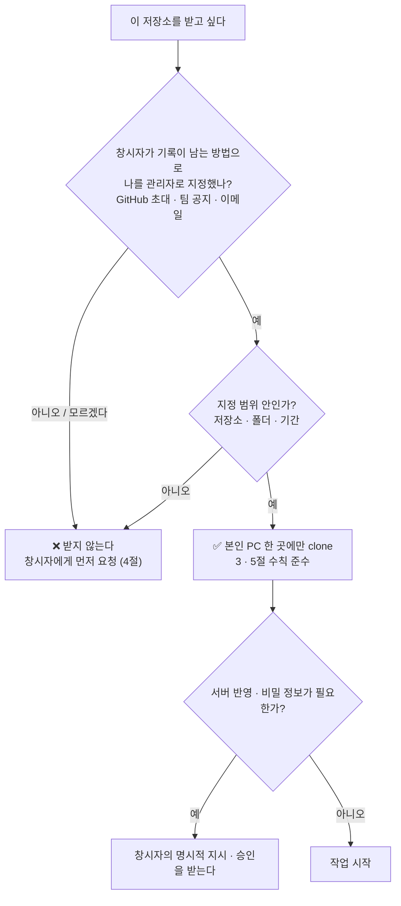
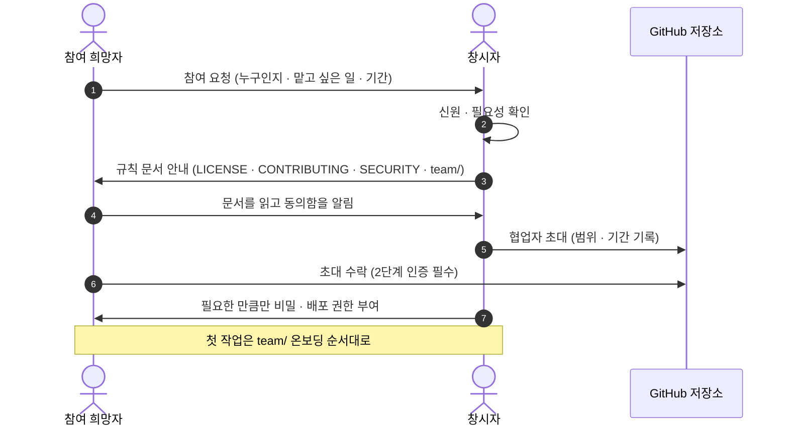
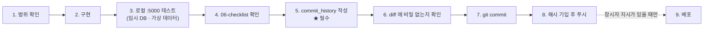
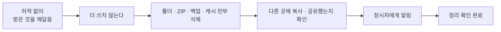

# 🤝 CONTRIBUTING — 사용 수칙 · 기여 방법

<div align="center">

**이 저장소는 오픈소스가 아닙니다. 코드가 보여도 사용 허락이 아닙니다.**

**창시자가 지정한 관리자만 clone · fork · 다운로드 · 실행할 수 있습니다.**<br />
그 외 모든 사람은 허락 전까지 **절대 불가**입니다.

[내가 clone 해도 되나?](#0-30초-판단) · [권한표](#1-누가-무엇을-할-수-있나) · [관리자가 되려면](#2-관리자가-되는-과정) · [금지 사항](#3-금지-사항) · [작업 방법](#5-작업-방법-관리자) · [AI 도구](#6-ai-도구-사용) · [창시자 설정](#7-창시자가-저장소에서-설정할-것) · [FAQ](#13-faq)

</div>

> 법적 근거: [LICENSE](./LICENSE) · 보안 제보: [SECURITY.md](./SECURITY.md) · 팀 규칙: [team/](./team/README.md) · AI 규칙: [.Agents/](./.Agents/README.md)

---

## 0. 30초 판단



**모르겠으면 지정되지 않은 것입니다.** 받기 전에 창시자에게 먼저 물어보세요.

---

## 1. 누가 무엇을 할 수 있나

| 할 수 있는 일 | 창시자<br/>`nomura-kanziro` | 지정 관리자 | 일반 팀원 · 외부인 |
|---|:---:|:---:|:---:|
| 사이트 이용 (화면 보기, 회원 기능) | ✅ | ✅ | ✅ |
| 저장소 **clone · fork · 다운로드** | ✅ | ✅ 지정 범위 | ❌ |
| 코드 수정 · 커밋 · 푸시 | ✅ | ✅ 지정 범위 | ❌ |
| 로컬 실행 · 테스트 | ✅ | ✅ | ❌ |
| **배포** (Pages · 서버) | ✅ | ⚠ 창시자 지시가 있을 때만 | ❌ |
| **서버 접속**(SSH) | ✅ | ⚠ 창시자가 키를 허락한 경우만 | ❌ |
| **비밀 정보** (`.env`, 키, DB 접속) | ✅ | ⚠ 필요한 항목만, 창시자 승인 | ❌ |
| **운영 DB** 직접 접근 | ✅ | ⚠ 원칙적으로 금지 (아래 참고) | ❌ |
| 관리자 사이트 계정 | ✅ | ⚠ 창시자가 발급한 것만 | ❌ |
| 관리자 지정 · 해제, 규칙 개정 | ✅ | ❌ | ❌ |

- **지정 관리자**는 창시자가 **기록이 남는 방법**(GitHub 협업자 초대, 팀 공지, 이메일)으로 정한 사람입니다. 구두 승낙, 추측, 다른 사람의 전달은 지정이 아닙니다.
- 지정에는 **범위**(저장소, 폴더, 기간)가 있습니다. 범위를 넘으면 지정되지 않은 것과 같습니다.
- 운영 DB는 사고 위험이 커서 개발에 쓰지 않습니다. 테스트는 **로컬 임시 DB + 가상 데이터**로 합니다(`docs/readme/tools/guard-env.js` 참고).
- 창시자 외에는 권한표를 바꿀 수 없습니다. 명단은 공개할 의무가 없습니다.

---

## 2. 관리자가 되는 과정



### 요청에 적을 것

```text
이름 / GitHub 아이디:
하고 싶은 일:
필요한 범위 (폴더 · 기능):
예상 기간:
사용할 PC · AI 도구:
```

### 지정 뒤 첫 날 (온보딩)

1. [`README.md`](./README.md) 로 사이트를 한 바퀴 둘러봅니다.
2. [`team/`](./team/README.md) 규칙 6개를 읽습니다. (특히 `01-rules`, `04-prohibitions`, `06-checklist`)
3. [`RDMD/summary/work-history.md`](./RDMD/summary/work-history.md) → [`RDMD/features/overview.md`](./RDMD/features/overview.md) → [`RDMD/guides/path-and-api.md`](./RDMD/guides/path-and-api.md)
4. [`RDMD/commit_history/README.md`](./RDMD/commit_history/README.md) 로 커밋 전 기록 규칙을 익힙니다.
5. 작은 작업(문서·문구)으로 한 번 커밋해 흐름을 확인합니다.

---

## 3. 금지 사항

> 모두 [LICENSE](./LICENSE) 제3조에 근거합니다. 알고도 어기면 고의 위반입니다.

### 누구에게나

| # | 금지 |
|:---:|---|
| 1 | 지정 관리자가 아닌 사람이 **clone · fork · ZIP · 미러링 · 스크래핑**하는 것 |
| 2 | 허락 없이 이 코드로 서비스를 만들거나 호스팅·배포하는 것 |
| 3 | 코드·데이터를 **공개 사이트·블로그·공개 Gist·질문 게시판·메신저 단체방**에 붙이는 것 |
| 4 | 라이선스 문구·저작권 표시를 지우는 것 |
| 5 | 코드·데이터를 **AI 학습·색인**에 쓰거나 저장소 전체를 외부 AI 서비스에 올리는 것 |
| 6 | 유사한 이름·로고로 혼동될 서비스를 만드는 것 |

### 지정 관리자에게 추가

| # | 금지 |
|:---:|---|
| 7 | 저장소·ZIP·일부 파일을 **다른 사람에게 전달**하거나 개인 저장소·클라우드 드라이브에 올리는 것 |
| 8 | 지정 범위를 넘어 다른 폴더·저장소·서버에 접근하는 것 |
| 9 | `.env`, 키, 토큰, DB 접속 정보를 **커밋·출력·채팅·스크린샷**으로 남기는 것 |
| 10 | 운영 DB·운영 서버에서 시험하거나 실제 회원 정보를 개발·캡처에 쓰는 것 |
| 11 | 창시자 지시 없이 배포하거나 서버를 바꾸는 것 |
| 12 | `root-render/`(베타 종료)를 수정하는 것 |
| 13 | 공용 PC·공유 계정에 저장소를 남겨 두는 것 |
| 14 | 다른 사람의 위반을 알고도 숨기는 것 |

---

## 4. 일반 팀원 · 외부인이 하고 싶은 것이 있다면

**clone 하지 말고 창시자에게 먼저 요청하세요.**

| 하고 싶은 일 | 방법 |
|---|---|
| 사이트를 쓰다가 만난 **버그·불편** | 사이트의 **문의하기** — ⚠ *다른 이용자에게 보일 수 있으니 개인정보·비밀번호·보안 내용은 쓰지 마세요* |
| 기능 **제안** | 문의하기 또는 창시자에게 직접 |
| **코드 기여**를 하고 싶다 | 2절 절차로 요청 → 지정 후 시작 |
| **보안 문제**를 찾았다 | 문의하기에 쓰지 말고 [SECURITY.md](./SECURITY.md) 1절의 비공개 채널로 |
| 코드·이미지를 **쓰고 싶다** | 복제하기 전에 [LICENSE](./LICENSE) 제14조대로 허락을 요청 |
| 소개·후기용 **화면 캡처** | 일반 화면은 가능. 코드·관리자 화면·타인 개인정보는 제외 ([LICENSE](./LICENSE) 제5조) |

---

## 5. 작업 방법 (관리자)

### 5-1. 시작 전

- [ ] 할 일을 **한 문장**으로 적을 수 있다
- [ ] 작업 범위가 **지정 범위 안**이다
- [ ] [`team/01-rules.md`](./team/01-rules.md) · [`04-prohibitions.md`](./team/04-prohibitions.md) 를 알고 있다
- [ ] 관련 `RDMD/features/*.md` 또는 해당 폴더 README 를 봤다
- [ ] `.env` 는 **로컬에만** 있고 커밋 대상이 아니다
- [ ] 디스크 암호화, 화면 잠금, 계정 **2단계 인증**을 켰다

### 5-2. 어디를 고치나

| 하는 일 | 작업 위치 |
|---|---|
| 화면 · 프론트 | **`root-cloudflare/src/`** (React) — 프론트는 여기서만 |
| API · DB | `backend/` |
| AI 도우미 | `ai-service/`, `ai-service/knowledge/` |
| 배포 스크립트 | `backend/deploy/oracle/` (실행은 창시자 지시) |
| 문서 | `RDMD/`, 각 폴더 README |
| ⛔ `root-render/` | **수정 금지** (2026-09-19 창시자 지시, 베타 종료) |

기능을 바꾸면 `ai-service/knowledge/*.md` 도 같이 고칩니다. (AI 도우미가 이 문서로 답합니다.)

### 5-3. 작업 흐름



```bash
# 로컬 실행 (풀기능 = 포트 5000)
cd root-cloudflare && npm install && npm run build
cd ../backend && npm install && npm start      # → http://localhost:5000
```

### 5-4. 커밋 규칙 (필수)

1. **`git commit` / `git push` 전에** `RDMD/commit_history/{본인이름}.md` 에 이번 커밋을 먼저 씁니다. (표 행 + 상세 블록, 맨 아래에 추가) — **로그 없이 커밋·푸시하면 규칙 위반입니다.**
2. 커밋 메시지는 **`type(scope): 한국어 설명`** — type 은 영어(`feat` · `fix` · `docs` · `chore` · `refactor` …), 콜론 뒤는 한국어.
3. commit_history 파일을 `git add` 에 포함합니다.
4. 커밋 후 실제 해시를 기록에 채우는 커밋을 따로 만듭니다 (`docs(commit_history): N번 커밋 해시 기입`).
5. 남의 `{이름}.md` 에 내 커밋을 쓰지 않습니다.

```text
feat(custom-maker): 이벤트 참여 버튼을 업로드 버튼 오른쪽으로 이동
fix(auth): 비밀번호 재설정 토큰 만료 시 안내 문구 수정
docs(readme): 루트 README 전면 개편
chore(gitignore): 추적하지 않는 파일 무시 목록에 추가
```

> 큰 기능은 `RDMD/frontend|backend/<기능>/*-record.md` 도 권장합니다. 상세: [`RDMD/guides/rdmd-writing.md`](./RDMD/guides/rdmd-writing.md)

### 5-5. 제출 전 체크리스트

```text
[ ] 변경이 요청 범위 안이고, 관련 없는 파일을 건드리지 않았다
[ ] 기존 주석을 지우지 않았다 (코드가 바뀌면 주석 문구만 수정)
[ ] 관리 기능이면 서버 requireAdmin + 프론트 getAdminAuthHeaders()
[ ] 경로는 React Router 절대 경로, 이미지는 tierImageUrl(), API 주소 하드코딩 없음
[ ] 포인트 · 확률 · 권한은 서버가 판정한다
[ ] :5000 에서 /health, 변경한 화면, (관리자 기능이면) 관리자 로그인 시나리오를 한 번씩 확인
[ ] 기능이 바뀌었으면 ai-service/knowledge 와 README 장면 · 숫자도 갱신
[ ] commit_history 작성 + 메시지 형식
[ ] diff 에 .env · 키 · 비밀번호 · 실제 회원 정보가 없다 (아래 명령)
```

```bash
git diff --cached | grep -nE "mongodb(\+srv)?://[^<[:space:]]+:[^<[:space:]]+@|BEGIN [A-Z ]*PRIVATE KEY|sk-ant-|ANTHROPIC_API_KEY=[^ ]|_SECRET=[^ ]"   # 아무것도 안 나와야 함
```

### 5-6. 리뷰

- **리뷰하는 사람**은 위 체크리스트와 [`team/04-prohibitions.md`](./team/04-prohibitions.md) 위반 여부를 먼저 봅니다.
- 공용 파일(`src/lib/api.js`, `Header.jsx`, `middleware/auth.js`)을 바꾸면 **회귀 테스트가 필수**입니다.
- "일단 전체 포맷", 의도하지 않은 대규모 리팩터는 받지 않습니다.
- 규칙 자체를 바꾸려면 **창시자 합의** 후 `.Agents` · `team` · 에이전트 폴더를 함께 고칩니다.

### 5-7. 개인 PC 수칙

| 하세요 | 하지 마세요 |
|---|---|
| 본인 PC **한 곳**에만 clone | 여러 PC·공용 PC·클라우드 동기화 폴더에 두기 |
| 작업이 끝나 필요 없으면 **폴더 삭제** | 오래된 사본을 방치하기 |
| 비밀은 비밀번호 관리자에 | 메모장·채팅·스크린샷에 저장 |
| 서버 키(SSH)는 `~/.ssh` 에 권한 600 | 저장소 안에 두기 |
| 의심스러우면 창시자에게 먼저 | 혼자 판단해 외부에 문의하기 |

---

## 6. AI 도구 사용

| 구분 | 규칙 |
|---|---|
| 허용 | 관리자가 **자기 PC에서** 개발을 돕는 용도로 쓰는 AI 도구 (Grok · Claude · Cursor · Codex 등) |
| 금지 | 저장소 **전체 또는 상당 부분을 외부 AI 서비스에 올리거나**, 학습·색인에 쓰는 것 |
| 책임 | AI 결과물도 이 라이선스를 따르며 **사람이 검토**하고 책임진다 |
| 맡기지 않는 일 | **배포, 푸시, 비밀 정보 접근, 서버 변경** — 창시자의 명시적 지시가 있을 때만 |
| 규칙 | [`.Agents/common-rules.md`](./.Agents/common-rules.md) 를 따른다. Admin AI(Grok · Claude · Cursor)끼리 해석이 다르면 사람에게 묻는다 |
| 받을 때 확인 | 금지사항을 어긴 줄이 없는지, 몰래 들어온 대규모 리팩터가 없는지, 지워진 기존 주석이 없는지, 테스트는 **내가** :5000 에서 했는지 |
| 키·대화 | AI 키는 `ai-service/.env` 에만. 사이트의 AI 도우미는 대화를 저장하지 않는다 |

---

## 7. 창시자가 저장소에서 설정할 것

문서만으로는 기술적으로 막을 수 없습니다. 아래 설정이 함께 있어야 이 문서가 실제로 지켜집니다.

> ⚠ GitHub **공개** 저장소는 누구나 clone 할 수 있고, GitHub 이용약관상 플랫폼 안에서 fork 도 가능합니다. 이 문서와 [LICENSE](./LICENSE)는 그 행위를 **금지하는 근거**일 뿐 막는 장치가 아닙니다.

| 확인 | 설정 | 효과 |
|:---:|---|---|
| ☐ | 저장소 **Private** 로 전환 (Settings → General → Danger Zone) | 지정 협업자만 접근. clone 을 실제로 막는 유일한 방법 |
| ☐ | 협업자는 지정 관리자만 (Settings → Collaborators), 최소 권한 | 명단과 권한 통제 |
| ☐ | 협업자 **2단계 인증** 의무화 | 계정 탈취로 인한 유출 방지 |
| ☐ | 브랜치 보호(`master`): 강제 푸시 금지, 필요 시 리뷰 필수 | 기록 보존 |
| ☐ | **Allow forking 해제** (조직 저장소인 경우) | fork 차단 |
| ☐ | **Private vulnerability reporting** 켜기 | 취약점을 비공개로 받음 |
| ☐ | **Secret scanning · Push protection** 켜기 | 비밀 푸시 차단 |
| ☐ | **Dependabot alerts** 켜기 | 의존성 취약점 알림 |
| ☐ | 퇴장·역할 종료 당일 협업자 삭제 | 오래된 권한 제거 |
| ☐ | 배포 토큰·SSH 키는 저장소 밖에서만 관리 | 서버 보호 |
| ☐ | 공개 상태였던 기간이 있다면 **그 기간에 노출된 비밀**이 있는지 점검·교체 | 공개 이력은 지워도 남음 |

> 이미 공개 상태에서 푸시된 내용은 Private 으로 바꿔도 **이미 복제된 사본은 회수할 수 없습니다.** 비밀이 들어갔다면 [SECURITY.md 8절](./SECURITY.md#8-유출-사고-대응) 대로 교체하세요.

---

## 8. 이미 clone 했다면 (허락 없이)



1. **더 쓰지 말고** 폴더 전체를 삭제합니다 (휴지통 비우기, ZIP, 클라우드 백업, 다른 PC 포함).
2. 어디에도 복사·공유·게시하지 않았는지 확인합니다.
3. 창시자에게 알립니다. **스스로 알리고 정리하면 고의 위반으로 다루지 않습니다.** ([LICENSE](./LICENSE) 제10조)

---

## 9. 관리자 활동이 끝날 때 (오프보딩)

창시자와 해당 관리자가 함께 확인합니다.

- [ ] GitHub 협업자 삭제 (창시자)
- [ ] 로컬 clone 폴더 · ZIP · 백업 · 캐시 **삭제** (본인)
- [ ] 받았던 비밀 정보 반납, **해당 비밀 교체** (창시자)
- [ ] 서버 SSH 공개 키 제거 (창시자)
- [ ] 발급해 준 관리자 사이트 계정 비활성화·비밀번호 변경 (창시자)
- [ ] 진행 중이던 작업을 `RDMD/` 에 기록하고 인수인계
- [ ] 개인정보·비밀 정보 비밀 유지 의무가 **이어진다**는 것을 확인 ([LICENSE](./LICENSE) 제8조·제9조)

---

## 10. 위반하면

| 단계 | 조치 |
|:---:|---|
| 1 | 경고, 삭제 요청 |
| 2 | 접근 권한 회수, 비밀 정보 교체 |
| 3 | 플랫폼 신고(침해 게시물 삭제 요청 등) |
| 4 | 법이 허용하는 법적 조치 ([LICENSE](./LICENSE) 제10조) |

고의성·피해 정도에 따라 단계를 건너뛸 수 있습니다.

---

## 11. 연락

| 용건 | 연락 |
|---|---|
| 참여·허락 요청 | GitHub `nomura-kanziro` 의 연락 수단 |
| 일반 버그·제안 | 사이트의 문의하기 (개인정보·보안 내용 금지) |
| **보안 문제** | [SECURITY.md](./SECURITY.md) 1절의 **비공개** 채널 |

---

## 12. 같이 보는 문서

| 문서 | 내용 |
|---|---|
| [LICENSE](./LICENSE) | 사용 권리·금지·소유권·제3자 권리 |
| [SECURITY.md](./SECURITY.md) | 보안 제보, 적용된 장치, 유출 대응, 개인정보 |
| [team/README.md](./team/README.md) | 사람 작업 규칙 6개 (규칙 · 흐름 · 스타일 · 금지 · 가이드 · 체크리스트) |
| [.Agents/README.md](./.Agents/README.md) | AI 공통 룰과 기능별 스킬 |
| [RDMD/commit_history/README.md](./RDMD/commit_history/README.md) | 커밋 기록 규칙 |
| [RDMD/guides/](./RDMD/guides/README.md) | 개발·보안·배포 가이드 |
| [README.md](./README.md) | 프로젝트 소개와 실행 방법 |
| [docs/readme/README.md](./docs/readme/README.md) | README 이미지를 안전하게 다시 만드는 법 |

---

## 13. FAQ

**Q. 공개 저장소인데 왜 clone 하면 안 되나요?**
A. 공개는 *볼 수 있다*는 뜻이지 *써도 된다*는 허락이 아닙니다. 사용 권리는 [LICENSE](./LICENSE) 에 따라 지정 관리자에게만 있습니다.

**Q. fork 도 안 되나요?**
A. 안 됩니다. fork 도 복제에 포함됩니다. GitHub 약관이 플랫폼 안의 fork 를 기술적으로 허용하더라도 이 라이선스의 금지가 풀리지 않습니다([LICENSE](./LICENSE) 제6조).

**Q. 코드 일부를 질문 사이트나 AI 채팅에 붙여 물어봐도 되나요?**
A. 외부 서비스에 붙이는 것은 금지입니다. 꼭 필요하면 **민감하지 않은 최소한의 조각**으로 줄이거나, 창시자에게 먼저 물으세요. 비밀·회원 정보는 어떤 경우에도 안 됩니다.

**Q. 사이트 화면을 캡처해서 블로그·SNS 에 올려도 되나요?**
A. 일반 이용자가 보는 화면은 소개·후기 목적으로 가능합니다. 코드, 관리자 화면, 타인 개인정보가 보이는 화면은 안 됩니다. 캐릭터 이미지의 권리는 원 권리자에게 있습니다.

**Q. 관리자인데 집 PC 에도 받아서 작업해도 되나요?**
A. 지정할 때 알린 PC 만 쓰세요. 새 PC 를 쓰려면 창시자에게 알리고, 디스크 암호화와 2단계 인증을 확인합니다.

**Q. 실제 사이트에서 시험해 봐도 되나요?**
A. 개발 시험은 로컬 임시 DB 로 합니다. 운영 사이트는 일반 이용자처럼만 쓰고, 취약점 시험은 [SECURITY.md](./SECURITY.md) 5절 규칙을 따릅니다.

**Q. 규칙이 헷갈려요.**
A. 창시자에게 물어보세요. 규칙끼리 어긋나면 **LICENSE > CONTRIBUTING > 나머지 문서** 순서이고, 사람과 AI 의 해석이 다르면 사람(창시자)이 정합니다.

---

## 개정 이력

| 버전 | 날짜 | 내용 |
|---|---|---|
| 2.0 | 2026-11-05 | 전면 개정 — 판단 흐름, 권한표 확장, 관리자 지정·오프보딩 절차, 작업·커밋·리뷰 규칙, AI 도구, 창시자 설정, FAQ |
| 1.0 | 2026-11-05 | 최초 작성 |
