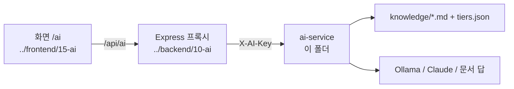

# RDMD/ai — AI 전용 서비스 기록

<!-- readme-overview -->
### 로직 구조 — AI 기능 하나가 세 곳에 걸친다

<!-- /readme-overview -->

저장소 루트 **`ai-service/`**(Python FastAPI · LangChain · LangGraph · RAG)는 Express 와 분리된 **별도 서비스**라서, 서비스 자체의 기록은 이 폴더에 둔다.
같은 작업의 **화면·프록시 조각은 기존 규칙대로 `frontend/`·`backend/` 에 기록**하고 서로 링크한다(AI 기능 하나가 세 곳에 걸치므로 아래 표를 같이 본다).

| 조각 | 위치 | 요약 |
|------|------|------|
| **AI 서비스 자체** | [01-ai-service-record.md](./01-ai-service-record.md) | FastAPI · LangGraph 흐름 · RAG(마크다운 지식 + tiers.json, 한국어 BM25) · Claude(LangChain) · fallback · 랜덤 추천 질문 · 설계 판단 · 남은 일 |
| 〃 (이어서) | [02-ollama-chromadb-record.md](./02-ollama-chromadb-record.md) | 생성 모델을 **Ollama gemma4:12b** 로(생각 모드 끔) · **ChromaDB + bge-m3** 벡터 검색(BM25 와 RRF 하이브리드) · 프롬프트 인젝션 차단 · 실측으로 정한 기준값·찾아 고친 문제 |
| 〃 (이어서) | [03-offline-doc-answer-knowledge-record.md](./03-offline-doc-answer-knowledge-record.md) | **AI 서버 ON/OFF 알림**("AI 서버 OFF 상태 (사이트의 정보내용을 끌어다 대답합니다.)") · 꺼져도 `knowledge/` 문서 문장 그대로 답하기 · 지식 8개→14개 고도화(FAQ·용어집·단계별·문제 해결·소통 기능·업데이트 이력) · 지식↔코드 동기화 테스트 |
| 〃 (이어서) | [04-production-deploy-prep-record.md](./04-production-deploy-prep-record.md) | **운영 VM(1GB) 배포 준비** — 서버 조건 점검, 지연 import·`requirements-prod.txt`, `deploy.sh` `ai-setup`/`ai-env` · pm2 `hbt-ai`, 묶음을 풀어 띄운 검증(서버 반영 전) |
| 〃 (이어서) | [05-oracle-storage-record.md](./05-oracle-storage-record.md) | **Oracle 저장(통계·대화 원문, 기본 꺼짐)** + 새 Oracle VM 전환 — 테이블·스위치·`deploy.sh` 새 명령·ACL/지갑/비밀번호 처리 · 확인 결과 |
| 〃 (이어서) | [06-agent-bot-record.md](./06-agent-bot-record.md) | **에이전트 봇**(`app/Agent-Bot`) — 작업 5종(티어표 초안·분석·요약·브리핑·검색), 규칙 우선 판별 + LLM 보조, 도구가 계산·LLM 은 해설, NDJSON 스트리밍, 실측 속도, 넣은 기능·뺀 기능 |
| Express 프록시(에이전트 봇) | [`../backend/10-ai/02-agent-bot-proxy-record.md`](../backend/10-ai/02-agent-bot-proxy-record.md) | `/api/ai/agent` — 회원 확인 · 작업 강도별 포인트 차감·환불 · 스트림 전달 · ai-service 전용 조회 API |
| 화면(에이전트 봇) | [`../frontend/15-ai/02-agent-bot-ui-record.md`](../frontend/15-ai/02-agent-bot-ui-record.md) | 오른쪽 아래 원형 버튼 · 대형 모달 · 닫아도 계속되는 작업 · 초안을 커스텀 메이커로 |
| 기능 설명(에이전트 봇) | [`../features/agent-bot.md`](../features/agent-bot.md) | 작업·요금·흐름·평가·운영 반영 방법 |
| Express 프록시 | [`../backend/10-ai/01-ai-proxy-record.md`](../backend/10-ai/01-ai-proxy-record.md) | `/api/ai` — 입력 검사 · IP당 요청 제한 · 공유 키 · 장애 시 503 |
| 화면 | [`../frontend/15-ai/01-ai-helper-page-record.md`](../frontend/15-ai/01-ai-helper-page-record.md) | `/ai` 휴버봇 대화창 · 추천 질문 · 푸터/가이드 링크 |
| 기능 설명(what) | [`../features/ai-service.md`](../features/ai-service.md) | 구조·흐름·지식·설정·운영 배포 상태 |
| 서비스 README(how) | [`../../ai-service/README.md`](../../ai-service/README.md) | 실행·테스트·지식 고치기·운영 배포 절차 |
| 작업 규칙 | [`../../.Agents/skills/ai-service/SKILL.md`](../../.Agents/skills/ai-service/SKILL.md) | 모든 AI 공통 정본(Claude·Grok·Codex 팩은 복제본) |

## 기록 원칙 (AI 서비스 한정)

- 지식 문서(`ai-service/knowledge/*.md`)를 고친 커밋도 기록한다 — AI 답이 바뀌는 변경이다.
- 모델·프롬프트·검색 방식 변경은 **왜** 바꿨는지(답 품질 사례)를 남긴다.
- API 키·실제 대화 내용(개인정보)은 기록에 넣지 않는다.
