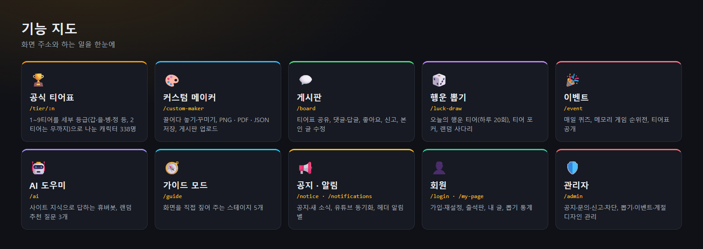
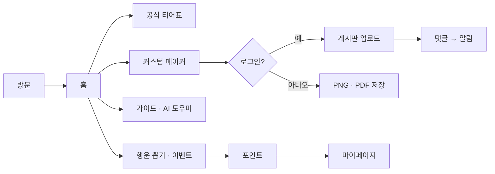

# 기능 설명 (Features)

<!-- readme-overview -->

### 로직 구조 — 사용자가 지나가는 길

<!-- /readme-overview -->

휴버대 티어표의 **구성 기능**을 영역별로 설명합니다.  
모듈 폴더의 README와 연동되어 있으며, 온보딩·유지보수 시 이 폴더부터 읽으면 됩니다.

## 문서 목록

| 문서 | 설명 |
|------|------|
| [overview.md](./overview.md) | 전체 기능 맵 · 폴더 대응 · 사용자 여정 |
| [common-infra.md](./common-infra.md) | Layout · Header · Footer, 경로 · API Base, 테마 · 계절 배경 |
| [tier-class.md](./tier-class.md) | 공식 1~9 티어표 |
| [custom-maker.md](./custom-maker.md) | 커스텀 제작 · 게시판 · 댓글 · 본인 글 수정 |
| [auth.md](./auth.md) | 회원가입 · 로그인 · 비번 재설정 |
| [notice.md](./notice.md) | 공지 · 새 소식 · 핀 |
| [inquiry.md](./inquiry.md) | 문의하기 · 답변 · 신고 |
| [admin.md](./admin.md) | 관리자 로그인 · 통합 관리 |
| [notifications.md](./notifications.md) | 알림 시스템 |
| [luck-draw.md](./luck-draw.md) | 행운 뽑기 (오늘의 행운 티어) |
| [my-page.md](./my-page.md) | 마이페이지 (프로필 드롭다운 + 내 활동 집계 + 출석판) |
| [ai-service.md](./ai-service.md) | **AI 도우미 · AI 전용 서비스** — `/ai` 챗봇 휴버봇 + 랜덤 추천 질문, `ai-service/`(FastAPI · LangChain · LangGraph · RAG) |
| [agent-bot.md](./agent-bot.md) | **휴버대 에이전트 봇** — 오른쪽 아래 원형 버튼, 티어표 초안·분석·요약·브리핑·검색 작업, 작업 강도별 포인트 요금, 넣은 기능·뺀 기능 평가 |
| [backend-api.md](./backend-api.md) | API 그룹 · 모델 · 미들웨어 |
| [react-rewrite.md](./react-rewrite.md) | **기획만** — 정식 버전 React 이식. Cloudflare 작업 중지. 구현 지시 전 스캐폴드 금지 |

## 코드 옆 README

| 기능 | 경로 |
|------|------|
| 백엔드 | [`backend/README.md`](../../backend/README.md) |
| Oracle 배포 | [`backend/deploy/oracle/README.md`](../../backend/deploy/oracle/README.md) |
| 프론트(React) | [`root-cloudflare/README.md`](../../root-cloudflare/README.md) |
| AI 전용 서비스 | [`ai-service/README.md`](../../ai-service/README.md) |

(예전 바닐라 모듈별 README — `admin/` · `custom-maker/` · `user_login/` · `notice/` · `Contact_us/` — 는 `root-render/`(베타 종료)에만 있다.)

## 읽는 순서 추천

1. **overview** → 전체 그림  
2. **common-infra** → 모든 페이지 공통 규칙  
3. 담당 기능 문서 (auth / custom-maker / admin 등)  
4. **backend-api** → API·권한 확인  
5. 필요 시 [`../guides/`](../guides/README.md) 가이드라인
