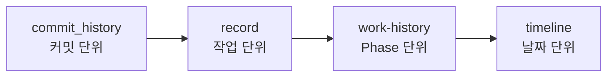

# Summary — 작업 정리

<!-- readme-overview -->
### 로직 구조

<!-- /readme-overview -->

지금까지의 개발을 **한곳에서 훑어보는** 요약 문서입니다.

| 문서 | 설명 |
|------|------|
| [work-history.md](./work-history.md) | Phase별 작업 정리 · 완성 기능 체크리스트 |
| [timeline.md](./timeline.md) | 개발 타임라인 |

상세 커밋 단위 로그:

- 프론트: [`../frontend/README.md`](../frontend/README.md)
- 백엔드: [`../backend/README.md`](../backend/README.md)

RDMD 전체 소개: [`../README.md`](../README.md)  
다음 단계: [../features/README.md](../features/README.md) → [../guides/README.md](../guides/README.md)
