<div align="center">

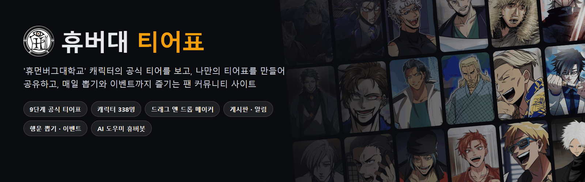

<br /><br />

<a href="https://human-bug-tier.com"></a>
<a href="./LICENSE"></a>
<a href="./CONTRIBUTING.md"></a>

<br />


<br /><br />

**'휴먼버그대학교' 캐릭터의 공식 티어를 보고, 나만의 티어표를 만들어 공유하고,<br />매일 뽑기와 이벤트까지 즐기는 팬 커뮤니티 사이트입니다.**

[기능 둘러보기](#-장면으로-보는-기능) · [프레임워크](#-프레임워크) · [아키텍처](#-아키텍처) · [로직 구조](#-로직-구조) · [실행 방법](#-시작하기) · [문서 지도](#-문서-지도)

</div>

> [!WARNING]
> **이 저장소는 오픈소스가 아닙니다.** 창시자가 지정한 관리자만 clone·fork·다운로드·실행할 수 있고, 그 외에는 허락 없이 사용할 수 없습니다.
> 규칙: [CONTRIBUTING.md](./CONTRIBUTING.md) · 법적 근거: [LICENSE](./LICENSE) · 보안 제보: [SECURITY.md](./SECURITY.md)

---

## 📌 한눈에 보기

| 숫자 | 내용 |
|:---:|---|
| **9** | 공식 티어 단계 (1티어 ~ 9티어) |
| **338** | 등록된 캐릭터 수 |
| **25** | React 페이지 |
| **11** | Express API 라우터 |
| **22** | MongoDB 컬렉션 모델 |
| **14** | AI 도우미가 읽는 지식 문서 |

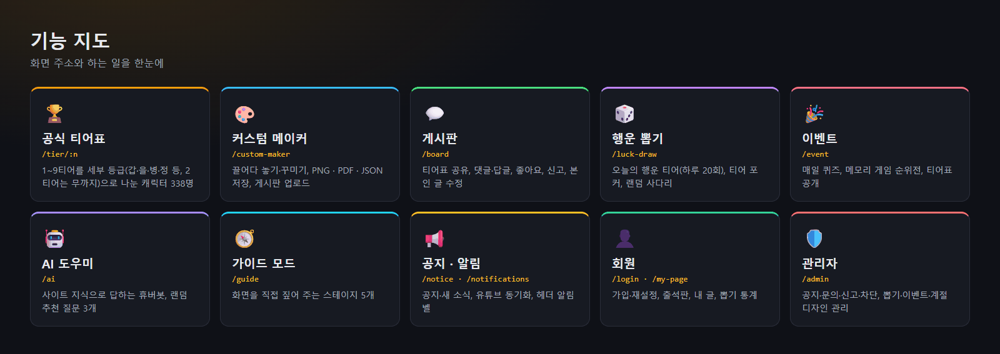

---

## 🧰 프레임워크

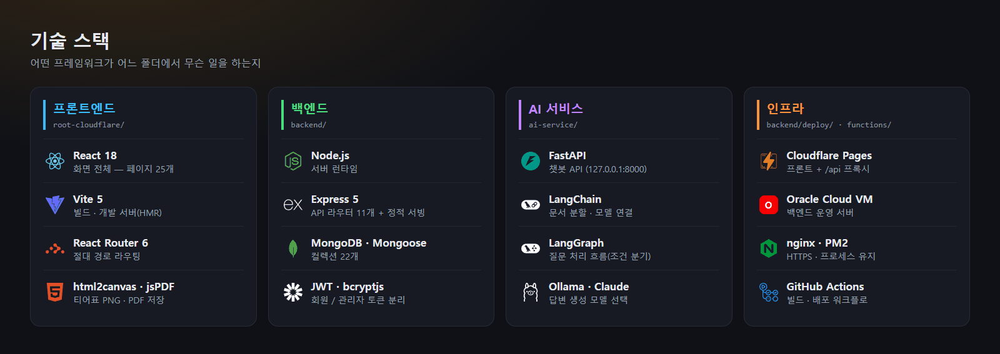

<details>
<summary><b>각 프레임워크를 이 프로젝트에서 어떻게 쓰는지 자세히 보기</b></summary>

| 프레임워크 | 맡은 일 | 코드 위치 |
|---|---|---|
| **React 18** | 모든 화면. 공식 티어표는 페이지 하나가 등급만 바꿔 그린다 | `root-cloudflare/src/pages/` |
| **Vite 5** | 개발 서버(5173, `/api` 는 5000 으로 프록시)와 `dist/` 빌드 | `root-cloudflare/vite.config.js` |
| **React Router 6** | 절대 경로 라우팅, 옛 바닐라 주소는 `LegacyRedirect` 가 새 주소로 안내 | `root-cloudflare/src/App.jsx` |
| **html2canvas · jsPDF** | 메이커 티어표를 PNG · PDF 로 저장 (필요할 때만 불러옴) | `src/lib/loadScript.js` |
| **Express 5** | API 라우터 11개, React 빌드 정적 서빙, SPA 폴백 | `backend/server.js`, `backend/routes/` |
| **Mongoose · MongoDB** | 회원, 게시글, 공지, 문의, 알림, 포인트, 이벤트 저장 | `backend/models/` |
| **JWT · bcryptjs** | 회원과 관리자 토큰 분리, 비밀번호 해시 | `backend/utils/jwtAuth.js`, `backend/middleware/auth.js` |
| **Nodemailer** | 가입 인증, 아이디·비밀번호 찾기 메일 | `backend/utils/mail.js` |
| **FastAPI** | AI 전용 서비스 API. Express 와 별도 프로세스 | `ai-service/app/main.py` |
| **LangGraph** | 질문을 분석해 검색·답변·거절로 나누는 흐름 | `ai-service/app/guidans_Chat/service/graph.py` |
| **LangChain** | 문서 분할, Ollama · Claude 모델 연결 | `service/knowledge.py`, `service/llm.py` |
| **ChromaDB · BM25** | 벡터 + 키워드 하이브리드 검색 (운영 VM 은 BM25 만) | `service/retrieval.py` |
| **Cloudflare Pages** | 프론트 호스팅, Pages Function 으로 `/api/*` 프록시 | `root-cloudflare/functions/api/[[path]].js` |
| **Oracle Cloud · nginx · PM2** | 운영 서버, HTTPS, 프로세스 상시 실행 | `backend/deploy/oracle/` |
| **GitHub Actions** | master 푸시 시 프론트 빌드·배포 워크플로 | `.github/workflows/` |

</details>

---

## 🏗 아키텍처

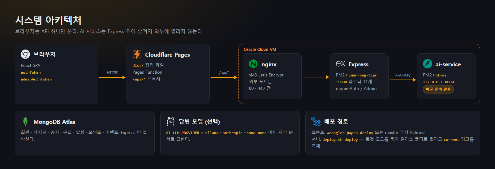

> [!NOTE]
> `ai-service` 의 운영 배포 스크립트는 준비되어 있지만 **아직 운영 서버에 올리지 않았습니다.** 지금은 로컬에서 동작합니다. 절차는 [`ai-service/README.md`](./ai-service/README.md) 를 보세요.

---

## 🎬 장면으로 보는 기능

> 아래 이미지는 모두 실제 사이트 코드를 **로컬 임시 DB + 가상 데이터**로 띄워 찍었습니다. 닉네임과 글은 지어낸 것이고, 실제 회원 정보는 들어 있지 않습니다.

### 🏆 공식 티어표 `/tier/:n`

<table>
<tr>
<td width="60%">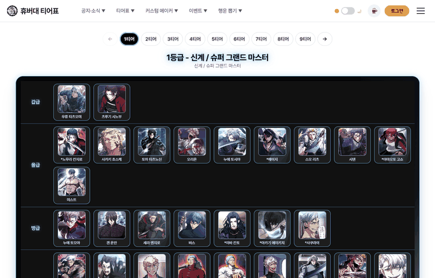</td>
<td>

- 위쪽 번호로 **1~9티어**를 전환합니다
- 페이지를 새로 읽지 않고 등급과 색만 바뀝니다
- 세부 등급으로 서열을 나눕니다. 2티어에는 **무급**이 있습니다
- 캐릭터 데이터는 `tiers.json` 하나가 정본입니다

</td>
</tr>
</table>

### 🎨 커스텀 메이커 `/custom-maker`

<table>
<tr>
<td width="60%">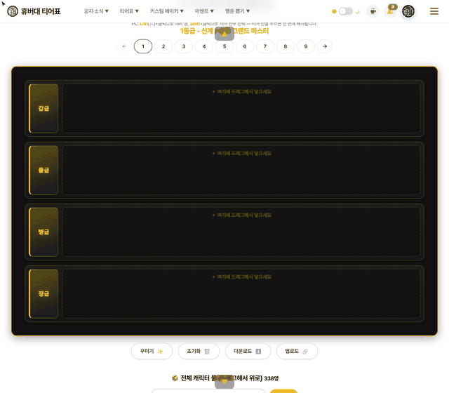</td>
<td>

- PC는 **끌어다 놓기**, 휴대폰은 **탭 선택 후 칸 탭**
- 이름으로 캐릭터 검색, 여러 명 한 번에 옮기기
- **꾸미기** 패널로 색과 스타일 변경
- **PNG · PDF · JSON** 저장
- 만든 표는 바로 게시판에 업로드

</td>
</tr>
</table>

### 💬 게시판 `/board`

<table>
<tr>
<td width="50%">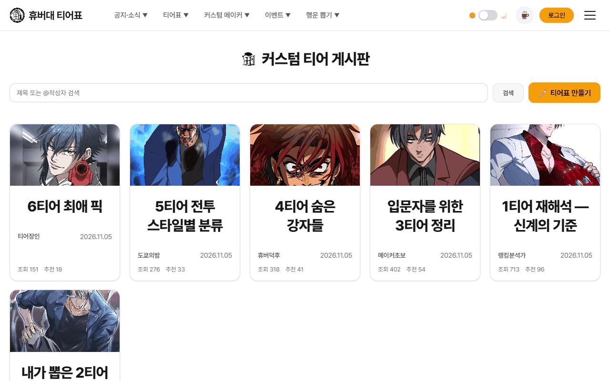</td>
<td width="50%">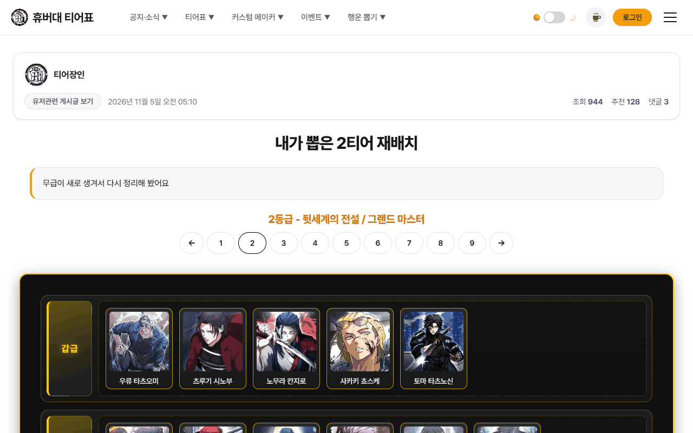</td>
</tr>
<tr>
<td align="center">목록과 검색</td>
<td align="center">상세 — 댓글·답글, 좋아요, 신고, 본인 글 수정</td>
</tr>
</table>

### 🎲 행운 뽑기 `/luck-draw`

<table>
<tr>
<td width="50%">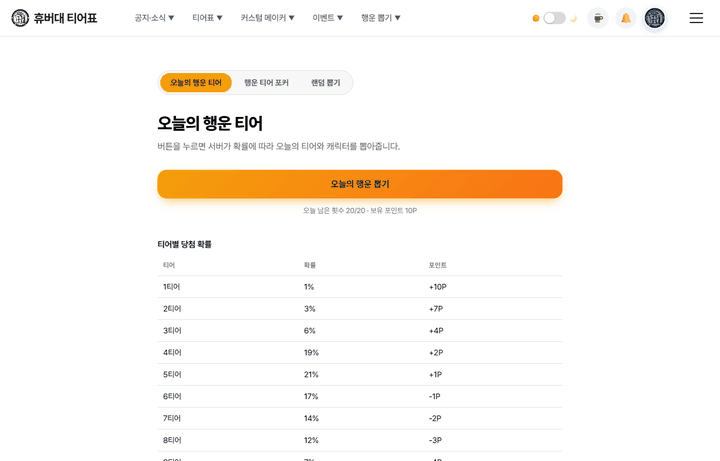</td>
<td>

**오늘의 행운 티어** — 회원은 하루 20회, 3분 간격

| 티어 | 1 | 2 | 3 | 4 | 5 | 6 | 7 | 8 | 9 |
|---|---|---|---|---|---|---|---|---|---|
| 확률(%) | 1 | 3 | 6 | 19 | 21 | 17 | 14 | 12 | 7 |
| 포인트 | +10 | +7 | +4 | +2 | +1 | −1 | −2 | −3 | −4 |

확률과 포인트는 **서버가 정합니다.** 화면은 결과만 표시합니다.

</td>
</tr>
</table>

<table>
<tr>
<td width="50%">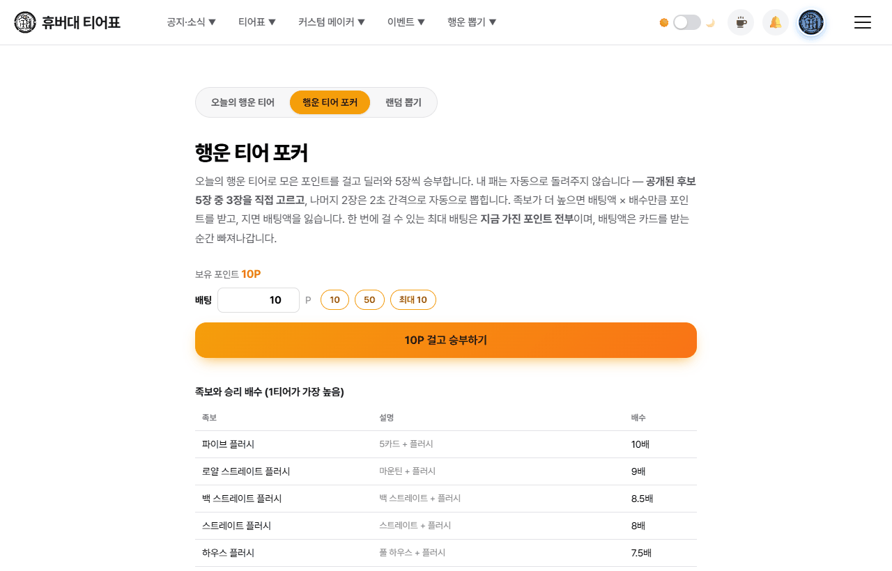</td>
<td width="50%">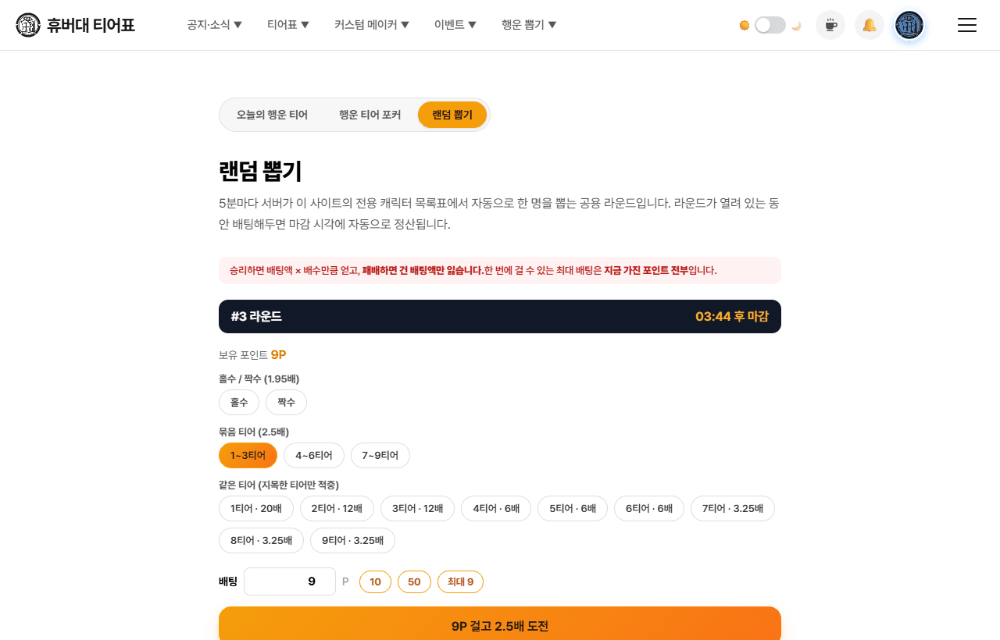</td>
</tr>
<tr>
<td align="center"><b>티어 포커</b> — 후보 5장 중 3장 선택, 2장은 자동</td>
<td align="center"><b>랜덤 뽑기</b> — 5분마다 도는 공용 라운드</td>
</tr>
</table>

### 🎉 이벤트 `/event`

<table>
<tr>
<td width="50%">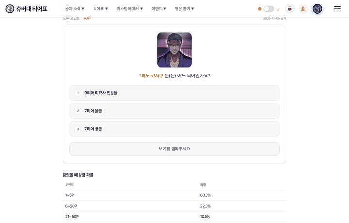</td>
<td width="50%">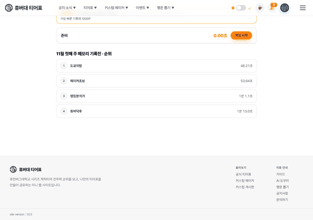</td>
</tr>
<tr>
<td align="center"><b>매일 퀴즈</b> — 하루 1회, 맞히면 1~1000P 추첨</td>
<td align="center"><b>메모리 게임</b> — 4×4 → 6×6 → 8×8, 기록은 서버 시계로 측정</td>
</tr>
</table>

### 🤖 AI 도우미 휴버봇 `/ai`

<table>
<tr>
<td width="60%">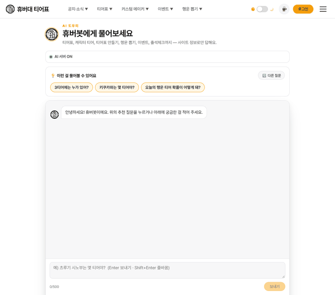</td>
<td>

- 사이트 지식 문서와 공식 티어표로만 답합니다
- 답 아래에 **참고한 문서**를 표시합니다
- 추천 질문 3개를 무작위로 보여 줍니다
- 모델이 꺼져 있으면 문서 문장으로 답하고 **OFF 상태**를 알립니다
- 대화는 저장하지 않습니다

</td>
</tr>
</table>

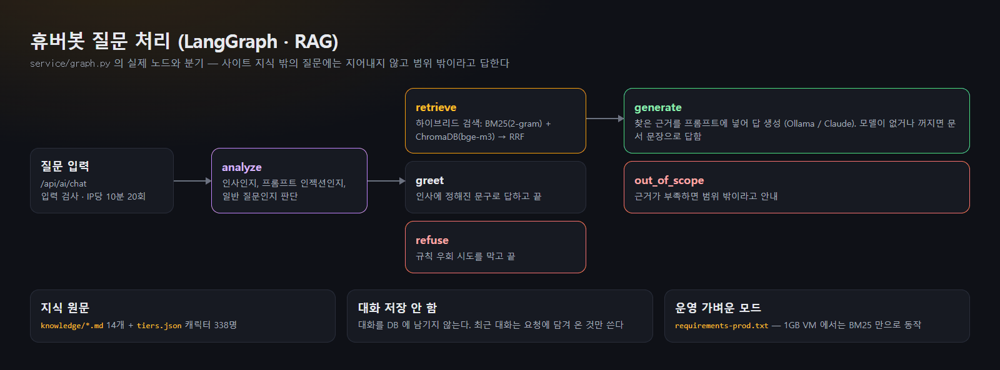

### 🧭 가이드 모드 `/guide`

<table>
<tr>
<td width="60%">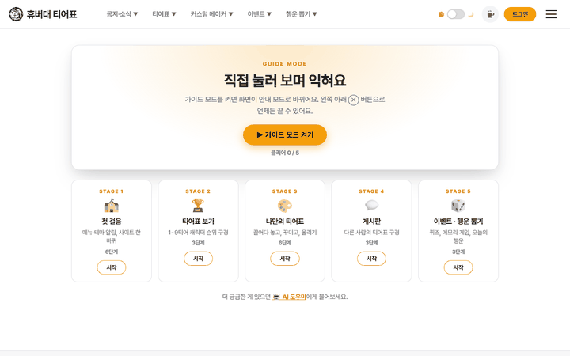</td>
<td>

- 화면을 어둡게 하고 **눌러야 할 곳을 직접 짚어** 줍니다
- 스테이지 5개: 첫 걸음, 티어표, 나만의 티어표, 게시판, 이벤트·행운 뽑기
- 왼쪽 아래 ✕ 로 언제든 종료
- 클리어 기록은 브라우저에만 저장

</td>
</tr>
</table>

### 👤 회원 · 알림 · 소통

<table>
<tr>
<td width="50%">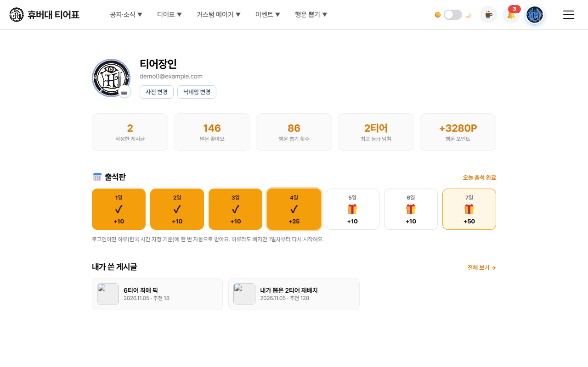</td>
<td width="50%">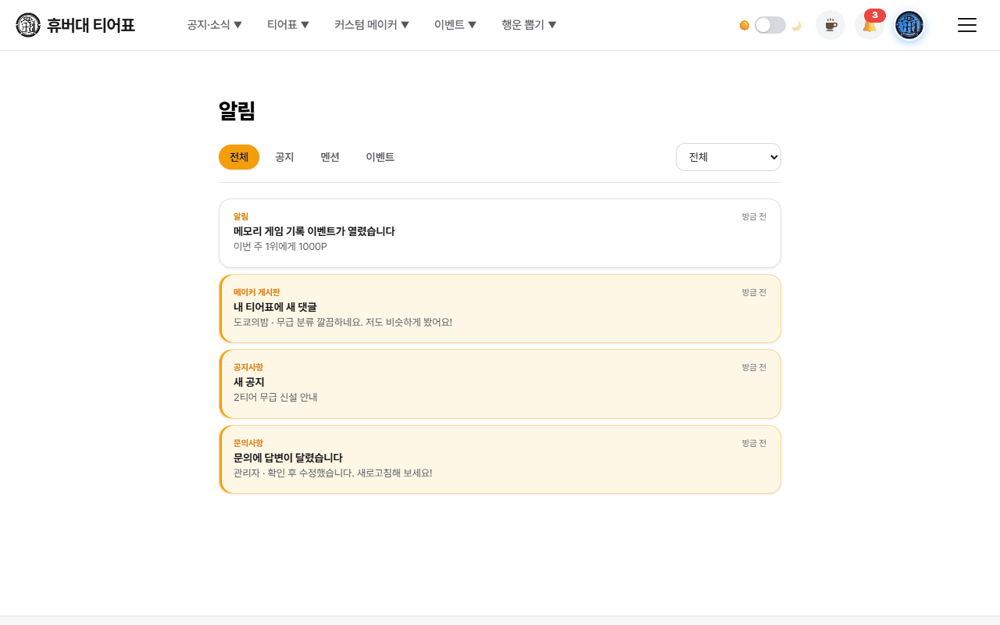</td>
</tr>
<tr>
<td align="center"><b>마이페이지</b> — 출석판(7일 주기 10·10·10·25·10·10·50P), 내 글, 통계</td>
<td align="center"><b>알림</b> — 댓글, 문의 답변, 공지, 이벤트 알림</td>
</tr>
<tr>
<td width="50%">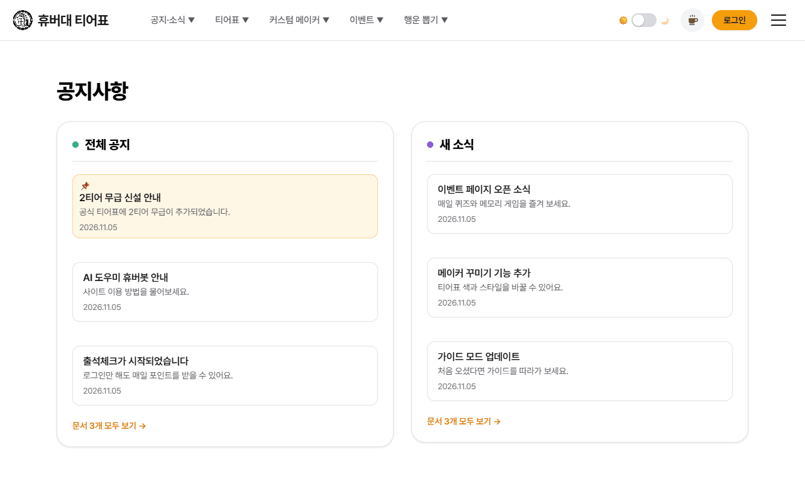</td>
<td width="50%">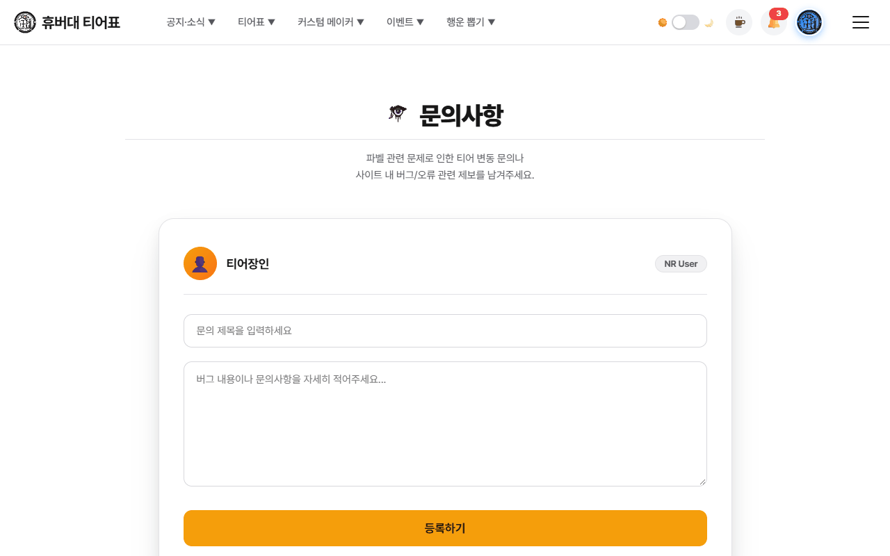</td>
</tr>
<tr>
<td align="center"><b>공지 · 새 소식</b> — 고정 글, 유튜브 커뮤니티 동기화</td>
<td align="center"><b>문의하기</b> — 관리자 답변, 추가 질문</td>
</tr>
</table>

### 🛡 관리자 `/admin`

<table>
<tr>
<td width="60%">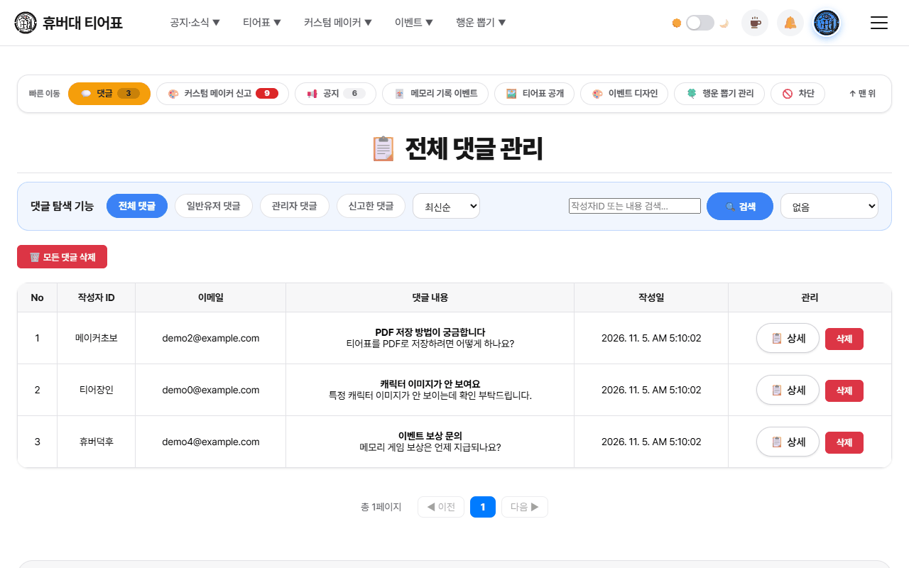</td>
<td>

- 공지 작성·수정·고정
- 문의 답변, 게시글·댓글 신고 처리
- 회원·IP 차단
- 뽑기 포인트 내역, 이벤트 회차 관리
- 계절 디자인 켜기·끄기

모든 관리 API 는 서버의 `requireAdmin` 이 검사합니다.

</td>
</tr>
</table>

### 🌗 테마 · 계절 디자인 · 모바일

<table>
<tr>
<td width="100%" colspan="2">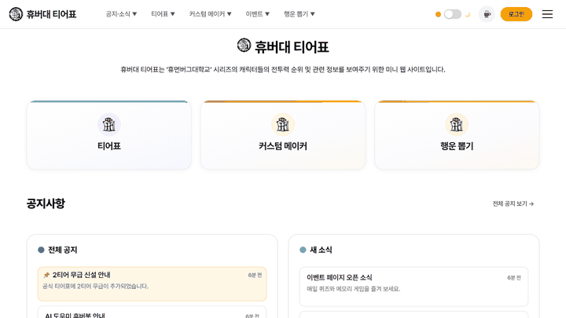</td>
</tr>
<tr>
<td width="50%">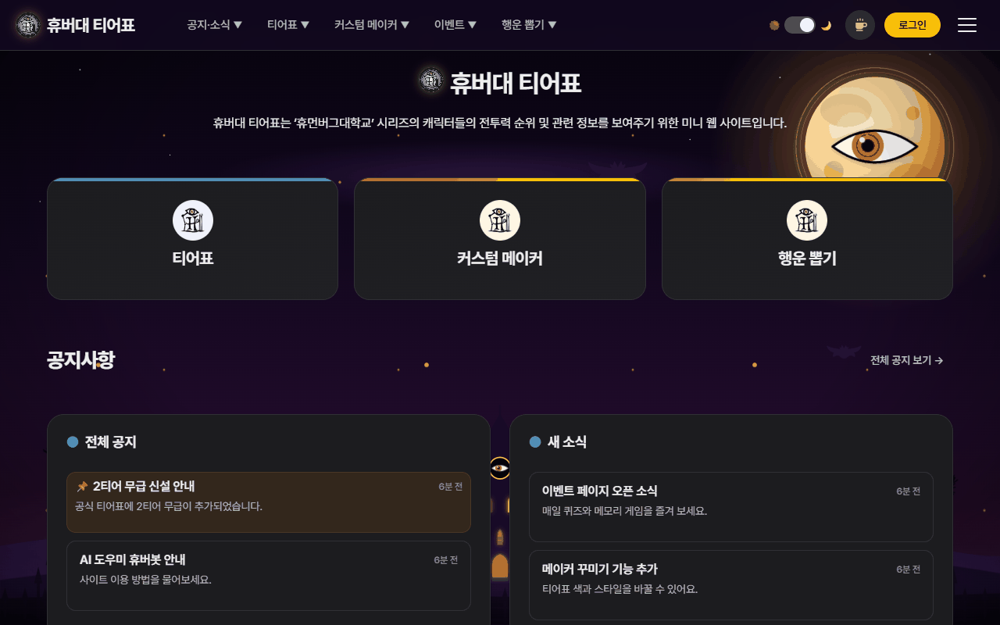</td>
<td width="50%">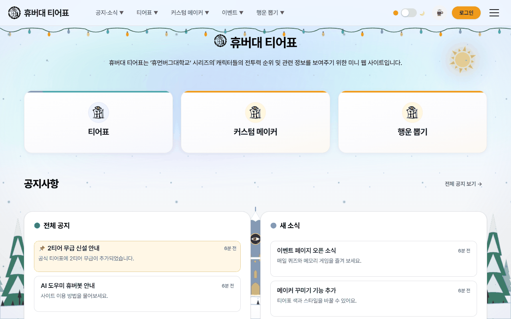</td>
</tr>
<tr>
<td align="center">할로윈 디자인</td>
<td align="center">크리스마스 디자인</td>
</tr>
</table>

<p align="center">
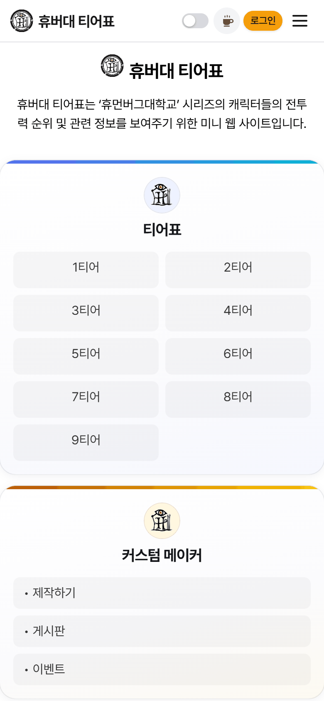
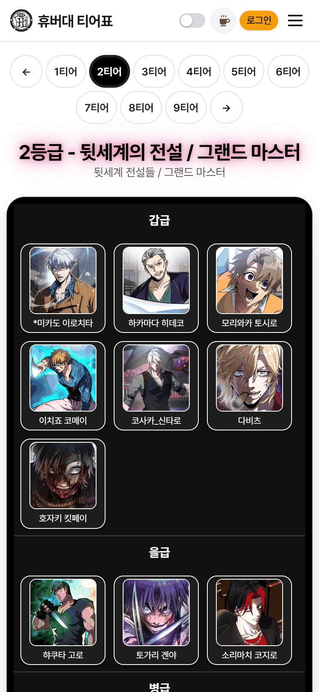
<br />
휴대폰에서도 같은 기능을 쓰고, 홈 화면에 추가(PWA)할 수 있습니다.
</p>

---

## 🧠 로직 구조

### 요청 한 건이 지나가는 길

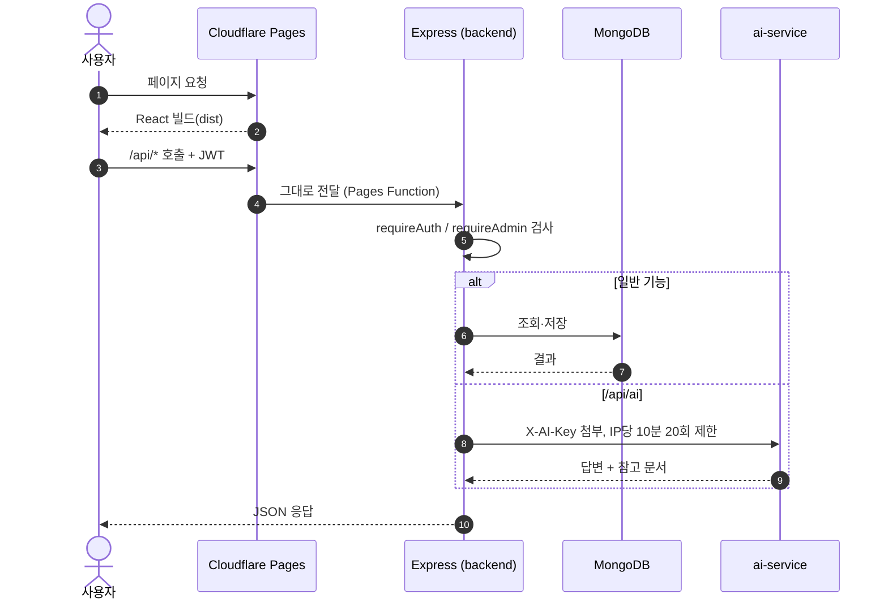

### 로그인과 권한

회원과 관리자는 **계정 컬렉션도, 토큰도 따로**입니다. 화면에서 숨기는 것으로 끝내지 않고 서버가 다시 검사합니다.

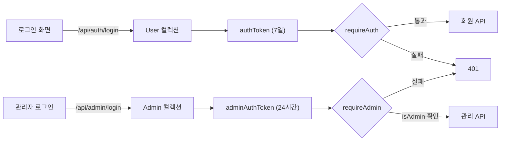

### 티어 데이터 흐름

`tiers.json` 한 파일을 고치면 티어표, 메이커, 퀴즈, AI 답변이 함께 따라옵니다. 행운 뽑기 풀만 `luckPool.js` 로 따로 관리합니다.

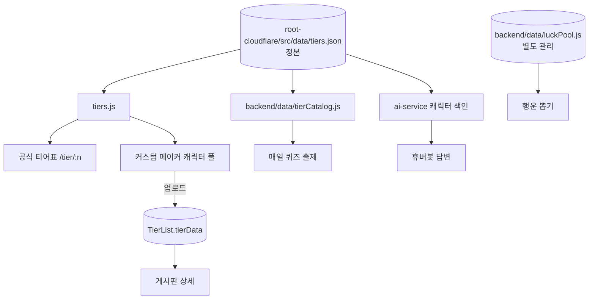

### 포인트가 걸린 기능은 서버가 판정

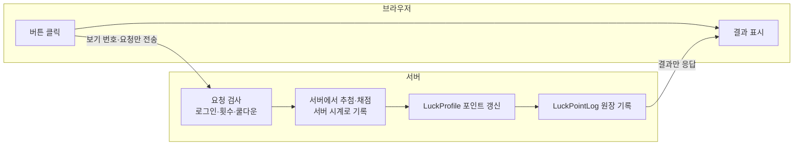

### 배포 흐름

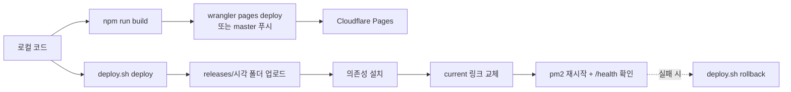

---

## 🚀 시작하기

> 지정 관리자만 해당합니다. ([CONTRIBUTING.md](./CONTRIBUTING.md))

**필요한 것:** Node.js, MongoDB 접속 정보. AI 도우미까지 보려면 Python과 Ollama도 필요합니다.

```bash
# 1. 프론트 빌드
cd root-cloudflare
npm install
npm run build

# 2. 서버 실행 (프론트 + API 통합)
cd ../backend
npm install
cp .env.example .env      # 값을 채운다. Windows 는 copy
npm start
```

→ **http://localhost:5000/**

<details>
<summary><b>프론트 개발 서버 (HMR)</b></summary>

```bash
cd root-cloudflare
npm run dev      # http://localhost:5173 — /api 는 :5000 으로 전달되므로 backend 도 함께 켠다
```

</details>

<details>
<summary><b>AI 도우미 함께 실행</b></summary>

```bash
ollama pull gemma4:12b
ollama pull bge-m3

cd ai-service
python -m venv .venv
.venv/Scripts/python -m pip install -r requirements.txt   # Linux/macOS: .venv/bin/python
.venv/Scripts/python -m uvicorn app.main:app --host 127.0.0.1 --port 8000
```

Ollama 가 꺼져 있으면 지식 문서 문장으로 답합니다. 자세한 내용: [`ai-service/README.md`](./ai-service/README.md)

</details>

### 환경 변수

| 변수 | 필수 | 설명 |
|---|:---:|---|
| `MONGO_URI` | ✅ | MongoDB 접속 문자열 |
| `ADMIN_INPUT_ID` · `ADMIN_INPUT_PW` | ✅ | 처음 만들 관리자 계정 |
| `JWT_SECRET` | 운영 필수 | 토큰 서명 키 |
| `EMAIL_USER` · `EMAIL_APP_PASSWORD` | 선택 | 메일 발송. 없으면 가입 즉시 인증 처리 |
| `APP_URL` | 운영 필수 | 메일 링크에 쓰는 주소 |
| `AI_SERVICE_URL` · `AI_SERVICE_KEY` | 선택 | AI 서비스 주소와 공유 키 |
| `YOUTUBE_POSTS_SYNC_ENABLED` | 선택 | `false` 면 유튜브 동기화 끔 |
| `STATIC_ROOT` | 선택 | 정적 프론트 폴더 강제 지정 |

> [!IMPORTANT]
> 읽는 순서는 루트 `.env` → `backend/.env` 이고, **`backend/.env` 가 셸 환경 변수까지 덮어씁니다.** `MONGO_URI` 를 셸에서 넘겨도 무시되니, 다른 DB 로 띄우려면 `backend/.env` 를 바꾸거나 [`docs/readme/tools/guard-env.js`](./docs/readme/tools/guard-env.js) 방식을 쓰세요. 비밀 값은 커밋하지 않습니다.

### 화면 주소

| 주소 | 화면 | 로그인 |
|---|---|---|
| `/` | 홈 | |
| `/tier/:n` | 공식 티어표 | |
| `/custom-maker` | 커스텀 메이커 | 업로드 시 |
| `/board` · `/board/post` · `/board/edit` | 게시판 · 상세 · 수정 | 작성·수정 시 |
| `/luck-draw` | 행운 뽑기 · 포커 · 랜덤 뽑기 | 저장·배팅 시 |
| `/event` | 퀴즈 · 메모리 게임 · 티어표 공개 | 참여 시 |
| `/ai` · `/guide` | AI 도우미 · 가이드 | |
| `/notice` · `/notice/:id` | 공지 · 새 소식 | |
| `/inquiry` | 문의하기 | 작성 시 |
| `/my-page` · `/notifications` | 마이페이지 · 알림 | ✅ |
| `/login` · `/signup` · `/find-account` · `/reset-password` | 인증 | |
| `/admin/login` · `/admin` | 관리자 | 관리자 |

### API

| 경로 | 기능 | 인증 |
|---|---|---|
| `/api/auth` | 가입, 로그인, 찾기, 재설정 | 공개 |
| `/api/tierlists` | 게시글, 댓글, 좋아요, 신고 | 일부 JWT |
| `/api/notices` | 공지, 새 소식 | 읽기 공개, 쓰기 관리자 |
| `/api/inquiries` | 문의, 답변 | 일부 JWT |
| `/api/notifications` | 알림 | JWT |
| `/api/luck-draw` | 뽑기, 포커, 사다리, 출석 | 일부 JWT |
| `/api/profile` | 프로필 | JWT |
| `/api/events` | 퀴즈, 메모리, 티어표 공개 | 일부 JWT · 관리자 |
| `/api/site` | 사이트 설정 공개 조회 | 공개 |
| `/api/ai` | AI 도우미 프록시 | 공개(제한 있음) |
| `/api/admin` | 관리 기능 | 관리자 |

---

## 📁 폴더 구조

```text
human-bug-tier/
├── root-cloudflare/      ✅ React 정식 프론트 — 프론트 작업은 여기서만
│   ├── src/pages/        화면 25개
│   ├── src/components/   헤더, 알림, 패널
│   ├── src/lib/          API, 경로, 테마, 가이드
│   ├── src/data/         tiers.json (티어 정본)
│   └── functions/api/    Pages /api 프록시
├── backend/              Express API + 정적 서빙
│   ├── routes/ · controllers/ · models/ · middleware/ · utils/
│   ├── data/             tierCatalog.js, luckPool.js
│   └── deploy/oracle/    운영 서버 배포 스크립트
├── ai-service/           FastAPI · LangGraph · RAG
│   ├── app/guidans_Chat/ 휴버봇 (6개 층)
│   ├── app/Agent-Bot/    에이전트 봇 자리 (계획 단계)
│   └── knowledge/        지식 문서 14개
├── root-render/          ⛔ 베타 종료 — 수정 금지 (보관용)
├── docs/readme/          README 이미지와 재생성 도구
├── RDMD/                 개발 기록 · 기능 설명 · 가이드
├── team/                 사람 작업 규칙
└── .Agents/ + .Claude/ · .Grok/ · .Cursor/ 외 9종   AI 작업 규칙
```

---

## 📦 배포

| 대상 | 방법 | 정본 문서 |
|---|---|---|
| **프론트** (Cloudflare Pages) | `root-cloudflare` 에서 `npx wrangler pages deploy dist --project-name=human-bug-tier` | [`CLOUDFLARE.md`](./CLOUDFLARE.md) |
| **백엔드** (Oracle VM) | `bash backend/deploy/oracle/deploy.sh deploy` | [`backend/deploy/oracle/README.md`](./backend/deploy/oracle/README.md) |
| **AI 서비스** (Oracle VM) | `deploy.sh ai-setup` → `ai-env` → `deploy` | [`ai-service/README.md`](./ai-service/README.md) |
| 배포 전 확인 | 체크리스트 | [`RDMD/guides/deploy-checklist.md`](./RDMD/guides/deploy-checklist.md) |

배포와 서버 변경은 **창시자의 지시가 있을 때만** 합니다. `root-render/`(Render.com)는 베타가 끝나 더 이상 고치지 않습니다.

---

## 🩺 문제 해결

| 증상 | 확인할 곳 |
|---|---|
| 페이지가 비어 있음 | `root-cloudflare` 에서 `npm run build` 했는지 |
| 링크 404 | `src/App.jsx` 라우트, `src/lib/paths.js` |
| 캐릭터 이미지가 깨짐 | `tierImageUrl()` 을 거쳤는지 |
| 관리자 401 | `adminAuthToken` 과 `getAdminAuthHeaders()` |
| 회원가입 실패 | `EMAIL_*` 설정, 미설정이면 즉시 인증 |
| 로그인·게시판이 안 됨 | `file://` 이나 정적 미리보기에서는 API 가 없음. `:5000` 으로 접속 |
| AI 답이 문서 문장만 나옴 | Ollama 실행 여부, `/api/ai/status` |
| 어느 DB 에 붙었는지 불확실 | `/health` 의 `db`, `backend/.env` 의 `MONGO_URI` |

---

## 📚 문서 지도

| 알고 싶은 것 | 문서 |
|---|---|
| 사용 수칙, clone 권한 | [CONTRIBUTING.md](./CONTRIBUTING.md) |
| 라이선스 | [LICENSE](./LICENSE) |
| 보안 제보, 비밀 정보 규칙 | [SECURITY.md](./SECURITY.md) |
| 프론트 | [root-cloudflare/README.md](./root-cloudflare/README.md) |
| 백엔드 | [backend/README.md](./backend/README.md) |
| AI 서비스 | [ai-service/README.md](./ai-service/README.md) |
| 운영 서버 | [backend/deploy/oracle/README.md](./backend/deploy/oracle/README.md) |
| 기능 설명 · 작업 이력 | [RDMD/README.md](./RDMD/README.md) |
| 사람 작업 규칙 | [team/README.md](./team/README.md) |
| AI 작업 규칙 | [.Agents/README.md](./.Agents/README.md) · [CLAUDE.md](./CLAUDE.md) · [AGENTS.md](./AGENTS.md) |
| README 이미지 다시 만들기 | [docs/readme/README.md](./docs/readme/README.md) |

<details>
<summary><b>AI 에이전트 폴더 전체 보기</b></summary>

| 구분 | 폴더 |
|---|---|
| **공통 정본** | [`.Agents/`](./.Agents/README.md) |
| **Admin AI** | [`.Grok/`](./.Grok/README.md) · [`.Claude/`](./.Claude/README.md) · [`.Cursor/`](./.Cursor/README.md) |
| **실무 AI** | [`.Codex/`](./.Codex/README.md) · [`.Antigravity/`](./.Antigravity/README.md) · [`.Manus/`](./.Manus/README.md) · [`.Qwen/`](./.Qwen/README.md) · [`.Gemini/`](./.Gemini/README.md) · [`.Ollama/`](./.Ollama/README.md) · [`.Opencode/`](./.Opencode/README.md) · [`.Kimi/`](./.Kimi/README.md) · [`.Windsurf/`](./.Windsurf/README.md) |

모든 에이전트 폴더는 `README.md` + `skills/<기능>/SKILL.md` 구조입니다.

</details>

---

## ⚖️ 라이선스

Copyright (c) 2026 nomura-kanziro. All Rights Reserved. **독점 라이선스**이며 창시자가 지정한 관리자만 사용할 수 있습니다. 자세한 내용은 [LICENSE](./LICENSE) 를 보세요.

'휴먼버그대학교' 관련 캐릭터 이름과 이미지의 권리는 각 원 권리자에게 있습니다. 이 사이트는 비공식 팬 사이트입니다.
