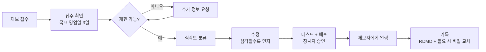
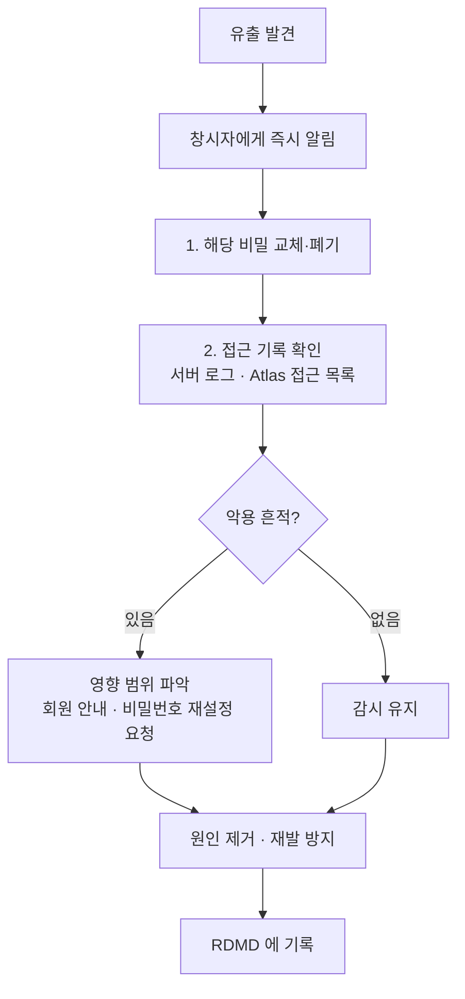
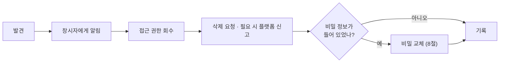

# 🔐 SECURITY — 보안 정책

회원 계정, 게시판, 관리자 기능, 포인트, AI 도우미, 그리고 운영 서버(Oracle Cloud · Cloudflare Pages · MongoDB Atlas)를 다루는 프로젝트의 보안 정책입니다.
취약점 제보 방법, 우리가 지키는 보안 규칙, 사고가 났을 때의 대응 순서를 한곳에 모았습니다.

<div align="center">

[제보하기](#1-제보하기) · [제보 양식](#2-제보-양식) · [처리 절차](#3-제보를-받으면-이렇게-처리합니다) · [범위와 규칙](#5-범위와-테스트-규칙) · [구현된 장치](#6-지금-적용된-보안-장치) · [비밀 정보](#7-비밀-정보-규칙) · [유출 대응](#8-유출-사고-대응) · [개인정보](#10-개인정보-다루기) · [FAQ](#13-faq)

</div>

> [!IMPORTANT]
> **취약점을 공개 이슈, 게시판, 사이트 문의하기, 단체 채팅방, SNS 에 올리지 마세요.**
> 사이트의 문의하기는 다른 이용자에게 보일 수 있습니다. 비공개 채널(아래 1절)로만 알려 주세요.

## 한눈에 보기

| 항목 | 내용 |
|---|---|
| 제보 채널 | GitHub **비공개 취약점 제보**(Security 탭 → *Report a vulnerability*), 또는 GitHub `nomura-kanziro` 로 **세부 내용 없이** 연락 |
| 접수 확인 목표 | 영업일 기준 **3일 이내** |
| 지원 대상 | 현재 운영 중인 최신 배포 버전 |
| 범위 | 사이트(`root-cloudflare/`), API(`backend/`), AI 서비스(`ai-service/`), 배포 설정 |
| 제외 | `root-render/`(베타 종료), 외부 서비스 자체의 문제, 사회공학, 물리적 접근, 서비스 거부 |
| 저장소 사용 권한 | 창시자가 지정한 관리자만 ([LICENSE](./LICENSE) · [CONTRIBUTING.md](./CONTRIBUTING.md)) |

---

## 1. 제보하기

### 방법 (위에서부터 시도)

| 순서 | 채널 | 설명 |
|:---:|---|---|
| 1 | **GitHub 비공개 제보** | 저장소 → **Security** → **Report a vulnerability**. 창시자에게만 보이고 공개되지 않습니다. |
| 2 | **GitHub `nomura-kanziro` 로 연락** | 1번이 열려 있지 않을 때. **"보안 제보가 있습니다"라고만** 알리고, 세부 내용은 창시자가 비공개 채널을 알려 준 뒤에 보냅니다. |

> 창시자 확인: 1번은 저장소 **Settings → Code security → Private vulnerability reporting** 을 켜야 동작합니다. 켜지 않았다면 켜세요. ([14절 체크리스트](#14-창시자-설정-체크리스트))

### 이렇게 하지 마세요

- 공개 이슈·PR·게시판·문의하기·SNS·단체방에 올리기
- 실제 비밀번호·토큰·개인정보를 제보에 그대로 붙이기 (일부만 가리고 보내세요)
- 취약점으로 얻은 정보를 다른 사람에게 알리거나 이용하기
- 다른 회원의 데이터를 열람·수정·삭제해 보기

---

## 2. 제보 양식

복사해서 채우세요. 모르는 칸은 비워도 됩니다.

```text
제목: (한 줄로 — 무엇이, 어디서)

1. 요약
   - 무엇이 문제인가요?

2. 위치
   - 화면 주소 또는 API (예: /api/…)
   - 로그인 여부 (비로그인 / 회원 / 관리자)

3. 재현 방법
   1)
   2)
   3)

4. 영향
   - 누가, 무엇을 할 수 있게 되나요? (정보 열람 / 변경 / 권한 상승 …)

5. 증거
   - 화면 캡처, 요청·응답 일부 (비밀번호·토큰·개인정보는 가려서)

6. 제안 (선택)
   - 고치는 방법에 대한 생각

7. 알게 된 시점 · 다른 곳에 알렸는지
```

---

## 3. 제보를 받으면 이렇게 처리합니다



- 처리 중에는 제보 내용을 비공개로 둡니다. 수정과 배포가 끝난 뒤에 알립니다.
- 수정은 배포되기 전까지 공개 저장소에 **취약점을 설명하는 커밋 메시지**로 올리지 않도록 합니다.
- 제보자가 원하면 해결 후 기여자로 감사 표시를 합니다(익명 요청도 가능).

---

## 4. 심각도 기준

| 심각도 | 예 | 처리 |
|:---:|---|---|
| 🔴 **치명** | 인증 없이 관리자 기능 사용, 다른 회원 계정 탈취, 비밀 정보·DB 직접 노출, 서버 원격 실행 | 즉시 대응, 임시 차단 우선 |
| 🟠 **높음** | 일반 회원이 권한 상승, 다른 회원의 개인정보 대량 열람, 포인트 조작 | 우선 수정 |
| 🟡 **보통** | 제한적인 정보 노출, 공격 조건이 까다로운 문제, 저장형 스크립트 삽입 | 일정에 맞춰 수정 |
| 🟢 **낮음** | 영향이 작거나 이론적인 문제, 보안 강화 제안 | 여유 있을 때 반영 |

---

## 5. 범위와 테스트 규칙

### 범위 안

| 대상 | 예 |
|---|---|
| 사이트 | 화면에서의 스크립트 삽입(XSS), 잘못된 권한 표시, 민감 정보가 화면·저장소에 남는 문제 |
| API (`backend/`) | 인증·인가 우회, 입력 검증 부족, 다른 회원 데이터 접근, 포인트·이벤트 판정 조작 |
| AI 서비스 (`ai-service/`) | 인증 키 우회, 프롬프트 인젝션으로 규칙 우회, 지식 밖 정보·비밀 노출 |
| 배포 설정 | 외부에 열린 포트, 시크릿이 담긴 설정, 권한이 넓은 토큰 |

### 범위 밖

- `root-render/`(베타 종료, 수정하지 않음)
- 외부 서비스 자체의 취약점(Cloudflare, Oracle, MongoDB Atlas, GitHub 등 → 해당 업체에 직접 보고)
- 사회공학(운영자·회원 속이기), 물리적 접근, 스팸·대량 요청·**서비스 거부 시험**
- 오래된 브라우저에서만 생기는 문제, 보안 영향이 없는 표시·문구 오류

### 시험할 때 지킬 것

1. **자신의 계정과 테스트 데이터**만 씁니다. 다른 회원의 데이터를 열람·수정·삭제하지 않습니다.
2. 운영 서버에 부하를 주지 않습니다(자동화 도구로 대량 요청 금지).
3. 취약점을 확인했으면 **거기서 멈추고** 바로 제보합니다. 더 깊이 들어가거나 데이터를 내려받지 않습니다.
4. 서버·계정에 대한 무단 접속, 비밀 정보 탈취·사용을 하지 않습니다.
5. 발견 내용은 수정될 때까지 다른 사람에게 알리지 않습니다.

> **선의의 제보:** 위 규칙을 지켜 선의로 한 제보와 시험에 대해서는 이 정책 위반으로 조치하지 않습니다. 규칙을 넘은 행위(데이터 열람·유출, 서비스 방해 등)는 보호받지 못합니다.

---

## 6. 지금 적용된 보안 장치

코드에서 확인한 것만 적었습니다. 새 장치를 넣거나 바꾸면 이 표도 함께 고칩니다.

### 계정·인증

| 항목 | 내용 | 위치 |
|---|---|---|
| 비밀번호 저장 | `bcryptjs` 해시(솔트 라운드 10), 원문 저장 안 함 | `authController.js` |
| 회원 / 관리자 분리 | 계정 컬렉션(`User` / `Admin`)과 토큰(`authToken` / `adminAuthToken`)이 따로. 한쪽이 뚫려도 다른 쪽에 영향 없음 | `models/`, `utils/jwtAuth.js` |
| 토큰 만료 | 회원 **7일**, 관리자 **24시간** | `utils/jwtAuth.js` |
| 관리 API 보호 | 서버 `requireAdmin` 미들웨어가 매번 검사. 화면에서 숨기는 것만으로 끝내지 않음 | `middleware/auth.js` |
| 비밀번호 재설정 | `crypto.randomBytes(32)` 랜덤 토큰, DB 에는 **SHA-256 해시만** 저장(토큰을 JWT URL 로 쓰지 않음) | `authController.js` |
| 이메일 인증 | 인증 토큰 유효 1시간 | `authController.js` |
| 차단 | 회원·IP 를 기간 단위로 차단(`Block`). 가입·로그인, 문의, 댓글, 프로필 변경에서 확인 | `utils/checkBlocked.js` |

### 서버 판정 (조작 방지)

| 항목 | 내용 |
|---|---|
| 행운 뽑기 | 확률·포인트·하루 20회·3분 간격을 서버가 정하고 `LuckProfile`/`LuckPointLog` 에 기록. 화면은 결과만 표시 |
| 이벤트 | 퀴즈 정답은 풀기 전에 내려주지 않고, 메모리 게임의 카드 배치·기록 시간은 서버가 측정(너무 빠른 완주 무효) |
| 포인트 원장 | 지급·차감 내역이 `LuckPointLog` 에 남아 관리자가 확인 |

### AI 서비스

| 항목 | 내용 |
|---|---|
| 외부 노출 차단 | `127.0.0.1:8000` 에만 바인드하고 8000 포트는 열지 않음. 브라우저는 `/api/ai` 만 호출 |
| 인증 | Express 가 `X-AI-Key` 를 붙여 호출하고, AI 서비스가 검사 |
| 요청 제한 | `/api/ai` 는 IP 당 10분 20회, 입력 길이 검사 |
| 프롬프트 인젝션 | 뻔한 규칙 우회 시도는 `analyze` 단계에서 막고 정해진 문구로 거절 |
| 대화 비저장 | 대화를 DB 에 남기지 않음 |
| 지식 범위 | 사이트 지식 문서와 공식 티어표 밖의 질문에는 지어내지 않고 범위 밖이라고 안내 |

### 인프라·저장소

| 항목 | 내용 |
|---|---|
| HTTPS | 정식 주소 `human-bug-tier.com`(Cloudflare Pages), 서버는 nginx + Let's Encrypt |
| 포트 | 외부에는 80·443(웹)과 22(SSH)만 개방, AI 서비스 포트는 열지 않음 |
| 요청 크기 | JSON 본문 2MB, nginx 업로드 5MB 제한 |
| 비밀 파일 | `.env` 계열은 `.gitignore`, 서버에서는 릴리스 밖 `shared/` 에 두고 링크로 연결 |
| 배포 | 의존성은 링크 교체 **전에** 설치해 실패해도 이전 버전 유지, `rollback` 지원 |
| 메일 | 서버 환경 변수가 없으면 메일을 보내지 않음(`/health` 로 설정 여부 확인) |

---

## 7. 비밀 정보 규칙

| 항목 | 규칙 |
|---|---|
| `.env`, 키, 토큰, DB 접속 문자열 | 커밋·출력·채팅·스크린샷 금지. `.env.example` 만 공유 |
| `JWT_SECRET` | **운영에서는 반드시 환경 변수로 설정.** 없으면 개발용 기본값으로 동작해 토큰을 위조할 수 있다. 길고 무작위인 값을 쓰고, 바꾸면 모든 로그인이 풀린다 |
| 관리자 계정 (`ADMIN_INPUT_ID/PW`) | 서버가 처음 뜰 때 계정을 만드는 용도. 강한 비밀번호를 쓰고 팀 채널에 올리지 않음 |
| 관리자 토큰 | `adminAuthToken` + 서버 `requireAdmin` 으로만 검증 |
| 비밀번호 재설정 | 랜덤 토큰 + SHA-256 해시만 DB 저장(JWT URL 방식 금지) |
| AI 키 (`ANTHROPIC_API_KEY`, `AI_SERVICE_KEY`) | `ai-service/.env` 또는 서버의 `shared/ai.env` 에만. 대화·로그에 남기지 않음. `deploy.sh ai-env` 는 값을 출력하지 않음 |
| 서버 접속 키 (SSH) | 저장소 밖, 본인 PC 에만. 공용 PC·클라우드 드라이브에 두지 않음 |
| Cloudflare / GitHub 토큰 | 필요한 권한만 가진 토큰을 쓰고 GitHub Secrets 에 저장 |
| 캡처·문서 | 실제 회원 닉네임·이메일이 보이는 화면을 올리지 않음. README 이미지는 가상 데이터 + `docs/readme/tools/guard-env.js` 로만 |

> ⚠ `backend/server.js` 는 `backend/.env` 를 셸 환경 변수보다 **우선해서** 읽습니다. 테스트하려고 `MONGO_URI` 를 셸에서 바꿔도 `.env` 의 DB(=운영일 수 있음)로 붙습니다. 테스트 전에 `/health` 의 `db` 와 `.env` 를 확인하세요.

### 커밋 전 확인

```bash
git diff --cached | grep -nE "mongodb(\+srv)?://[^<[:space:]]+:[^<[:space:]]+@|BEGIN [A-Z ]*PRIVATE KEY|sk-ant-|ANTHROPIC_API_KEY=[^ ]|_SECRET=[^ ]"
```

아무것도 나오지 않아야 합니다. 나오면 커밋하지 말고 값을 지운 뒤 다시 확인하세요.

---

## 8. 유출 사고 대응

비밀이 저장소·채팅·로그에 노출됐거나 노출이 의심되면 **지우는 것보다 교체가 먼저**입니다. 커밋 이력에서 지워도 이미 복제됐을 수 있습니다.



### 무엇을 교체하나

| 유출된 것 | 교체 방법 |
|---|---|
| `MONGO_URI` | MongoDB Atlas 에서 해당 DB 사용자의 비밀번호를 바꾸고 `shared/.env` 를 갱신 후 재시작. Atlas 접근 허용 IP 도 점검 |
| `JWT_SECRET` | 새 값으로 교체하고 재시작. **기존 로그인이 모두 풀립니다** |
| 관리자 비밀번호 | 서버가 `ADMIN_INPUT_*` 로 계정을 만드는 것은 **계정이 없을 때뿐**이므로, 환경 변수만 바꾸면 기존 계정에 반영되지 않을 수 있습니다. DB 의 관리자 계정을 직접 갱신하고 확인 |
| `EMAIL_APP_PASSWORD` | Google 계정에서 앱 비밀번호를 폐기하고 새로 발급 |
| `ANTHROPIC_API_KEY` | Anthropic 콘솔에서 키를 폐기하고 새로 발급, `shared/ai.env` 갱신 |
| `AI_SERVICE_KEY` | `deploy.sh ai-env` 를 다시 실행해 새 값을 만들고(백엔드·AI 서비스에 같은 값) 두 프로세스 재시작 |
| SSH 키 | 서버의 `authorized_keys` 에서 제거하고 새 키 발급 |
| Cloudflare / GitHub 토큰 | 토큰 폐기 후 재발급, GitHub Secrets 갱신 |

### 개인정보가 새어 나갔다면

1. 어떤 정보(이메일·닉네임·IP 등)가 얼마나, 언제부터 노출됐는지 확인합니다.
2. 노출을 멈춥니다(해당 화면·API 차단 또는 수정 배포).
3. 영향받은 회원에게 알리고, 필요하면 비밀번호 재설정을 안내합니다.
4. 법령이 정한 신고·통지 의무가 있는지 창시자가 판단합니다.

---

## 9. 허락 없는 저장소 접근

지정 관리자가 아닌 사람이 저장소를 복제·내려받은 것을 발견하면 창시자에게 알려 주세요.



- 스스로 알리고 삭제한 경우는 고의 위반으로 다루지 않습니다([LICENSE](./LICENSE) 제10조).
- 저장소가 공개 상태라면 문서만으로 복제를 막을 수 없습니다. 비공개 전환과 협업자 제한은 [CONTRIBUTING.md 7절](./CONTRIBUTING.md#7-창시자가-저장소에서-설정할-것)을 보세요.

---

## 10. 개인정보 다루기

### 수집·보관하는 정보

| 정보 | 용도 | 비고 |
|---|---|---|
| 이메일, 닉네임 | 계정, 알림, 메일 | 비밀번호는 해시로만 저장 |
| IP | 차단·악용 대응 (가입·문의·댓글 작성 시 기록) | 개인정보로 취급 |
| 게시글·댓글·문의 | 서비스 제공 | **문의하기·게시글은 다른 이용자에게 보일 수 있음** |
| 포인트·출석·뽑기 이력 | 서비스 제공 | 뽑기 이력은 최근 5건만 보관 |
| AI 대화 | — | **저장하지 않음** |

### 규칙

- 운영 중 알게 된 회원 정보를 **업무 외 목적으로 쓰거나 외부에 알리지 않습니다.**
- 회원에게 개인정보를 문의하기·게시글에 쓰지 않도록 안내합니다.
- 개발·캡처에 **실제 회원 데이터를 쓰지 않습니다.** 필요하면 가상 데이터로 만듭니다.
- 로그·스크린샷·이슈에 이메일·IP 가 들어가지 않게 가립니다.
- 계정 삭제·탈퇴 요청이 오면 창시자가 처리 범위를 정합니다. (대화·사용자 데이터를 새로 저장하는 기능을 만들기 전에는 보관 기간과 삭제 방법을 먼저 정합니다. → [`RDMD/guides/security.md`](./RDMD/guides/security.md) 9절)

---

## 11. 개발할 때 보안 규칙

새 기능을 만들거나 고칠 때 [`team/04-prohibitions.md`](./team/04-prohibitions.md) 와 아래를 확인합니다.

| 상황 | 규칙 |
|---|---|
| 새 API | 누가 쓰는지(비로그인/회원/관리자)를 먼저 정하고 라우터에 `requireAuth` / `requireAdmin` 을 붙인다 |
| 관리 기능 | 서버 `requireAdmin` + 프론트 `getAdminAuthHeaders()`. 화면 숨김만으로 끝내지 않는다 |
| 사용자 값 | 서버가 `body` 로 받은 사용자·권한 값을 그대로 믿지 않는다. 신원은 **토큰**에서 읽는다 |
| 소유권 | 수정·삭제 API 는 본인 글인지 서버에서 확인한다 |
| 포인트·확률 | 서버가 정하고 기록한다. 화면은 표시만 |
| 화면 출력 | 사용자가 쓴 글을 HTML 로 그대로 넣지 않는다(React 기본 이스케이프를 우회하는 `dangerouslySetInnerHTML` 는 신중히) |
| 외부 요청 | 사용자가 준 주소로 서버가 요청하는 기능을 만들지 않는다 |
| 응답 | 필요한 필드만 내려준다. IP·이메일·해시 같은 내부 값은 응답에서 뺀다 |
| 의존성 | 새 패키지는 꼭 필요한 것만, 버전을 고정한다 |
| 로그 | 비밀번호·토큰·이메일을 로그에 출력하지 않는다 |

> 이미 있는 코드가 이 규칙과 어긋나 보이면 **공개 이슈로 올리지 말고** 창시자에게 알려 주세요(1절).

---

## 12. 배포·서버 수칙

- 배포와 서버 변경은 **창시자의 명시적 지시가 있을 때만** 합니다. (AI 도구에게 맡기지 않습니다.)
- 배포 전 [`RDMD/guides/deploy-checklist.md`](./RDMD/guides/deploy-checklist.md) 를 확인합니다. `.env` 가 git 에 없는지, 관리자 계정·JWT 강도를 봅니다.
- 배포 후 `/health` 와 핵심 시나리오를 확인하고, 문제가 있으면 `deploy.sh rollback` 으로 되돌립니다.
- 서버의 `shared/` 폴더(`.env`, `ai.env`)는 배포 산출물에 섞이지 않게 합니다(`deploy.sh package` 가 `.env*` 를 제외).
- 서버 접속은 본인 PC 의 SSH 키로만 하고, 접속 기록이 필요하면 창시자에게 요청합니다.
- 의존성 점검: 배포 전 `npm audit`(백엔드·프론트)와 `pip list --outdated`(ai-service)를 가끔 확인하고, 심각한 경고는 창시자에게 알립니다.

---

## 13. FAQ

**Q. 저장소가 공개돼 있는데 clone 하면 왜 안 되나요?**
A. 공개는 사용 허락이 아닙니다. [LICENSE](./LICENSE) 에 따라 지정 관리자만 쓸 수 있습니다.

**Q. 취약점을 찾았는데 보상이 있나요?**
A. 금전 보상 제도는 없습니다. 원하시면 해결 후 감사 표시를 합니다.

**Q. 제보한 뒤 얼마나 걸리나요?**
A. 접수 확인은 영업일 기준 3일 안을 목표로 합니다. 수정 시간은 심각도와 난이도에 따라 달라지며, 진행 상황은 알려 드립니다.

**Q. 제보하려고 직접 시험해 봐도 되나요?**
A. 자기 계정과 테스트 데이터로, 확인하는 선까지만 가능합니다(5절). 다른 회원 데이터나 서버에는 접근하지 마세요.

**Q. 제 계정이 도용된 것 같아요.**
A. 사이트에서 비밀번호를 바꾸고(찾기·재설정), 문의가 필요하면 개인정보 없이 알려 주세요. 의심되는 시각·행동을 적어 주시면 확인합니다.

**Q. 문의하기에 비밀번호나 개인정보를 적어도 되나요?**
A. 안 됩니다. 문의하기는 다른 이용자에게 보일 수 있습니다.

---

## 14. 창시자 설정 체크리스트

문서만으로는 지켜지지 않는 것들입니다. 한 번 확인해 두세요.

- [ ] 저장소 **Private** 여부 결정 (공개이면 누구나 clone 가능)
- [ ] **Private vulnerability reporting** 켜기 (Settings → Code security)
- [ ] **Dependabot alerts** 켜기 (의존성 취약점 알림)
- [ ] **Secret scanning · Push protection** 켜기 (비밀 푸시 차단)
- [ ] 협업자 2단계 인증, 최소 권한
- [ ] 운영 `JWT_SECRET` 이 환경 변수로 설정돼 있는지 확인
- [ ] 외부 포트 점검(80·443·22 외 개방 없음, AI 서비스 8000 비개방), SSH 는 키 인증만
- [ ] 정기적으로 비밀 교체 주기 정하기(관리자 비밀번호, API 키)

---

## 지원 버전과 개정

- 지원: 현재 운영 중인 최신 배포 버전만 지원합니다. `root-render/`(베타 종료)는 수정·지원하지 않습니다.
- 이 문서는 창시자가 바꿉니다. 변경 이력은 git 이력으로 남습니다.

| 버전 | 날짜 | 내용 |
|---|---|---|
| 2.0 | 2026-11-05 | 전면 개정 — 제보 채널(비공개로 변경), 양식, 처리 절차, 심각도, 적용된 장치, 유출 대응, 개인정보, 개발·배포 수칙, FAQ |
| 1.0 | 2026-11-05 | 최초 작성 |
