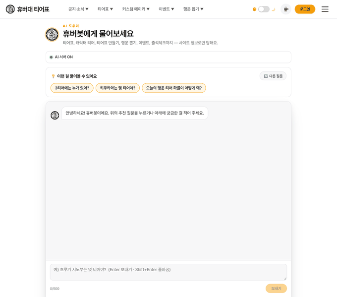
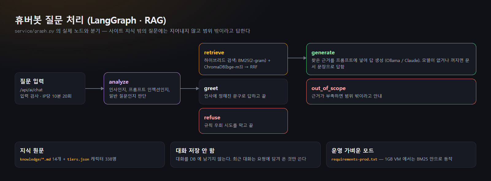
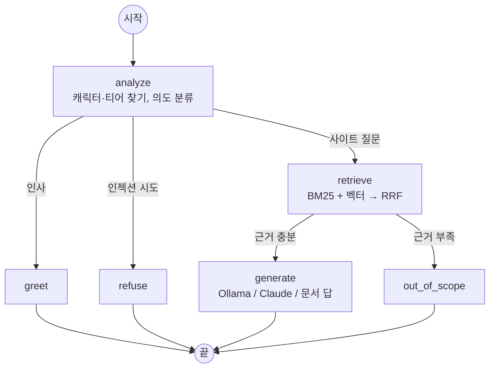
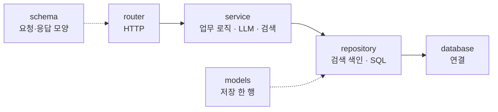

# ai-service — 휴버대 티어표 AI 전용 서비스

<!-- readme-overview -->
    

<table>
<tr>
<td width="50%"></td>
<td>

- 사이트 지식 문서 + 공식 티어표로만 답합니다
- 답 아래에 참고한 문서를 보여 줍니다
- 모델이 꺼져 있으면 문서 문장으로 답합니다
- 대화를 저장하지 않습니다
- **운영 서버에는 아직 올리지 않았습니다** (스크립트는 준비됨)

</td>
</tr>
</table>



### 로직 구조

**질문 처리** (`service/graph.py` 의 실제 노드와 분기)



**코드 층** (위에서 아래로만 호출)


<!-- /readme-overview -->

사이트 지식으로 답하는 챗봇 **휴버봇**(`/ai` 화면)과 **랜덤 추천 질문 3개**를 만드는 Python 서비스다.
Express(`backend/`)와 **별도 프로세스**로 돌고, 브라우저는 이 서비스를 직접 부르지 않는다.

```
브라우저 /ai ──▶ /api/ai/*  (Cloudflare Pages /api 프록시 → Oracle Express, 또는 로컬 :5000)
                  │  backend/routes/aiRoutes.js — 입력 검사 · IP당 10분 20회 제한 · X-AI-Key 첨부 · 대화 저장 안 함
                  ▼
           ai-service (FastAPI, 127.0.0.1:8000)
                  │  LangGraph: analyze → retrieve(RAG) → generate / greet / refuse / out_of_scope
                  ├─ 지식: knowledge/*.md (사이트 이용 안내) + root-cloudflare/src/data/tiers.json (공식 티어표)
                  ├─ 검색: 하이브리드 = 한국어 2-gram BM25 + ChromaDB 벡터(Ollama bge-m3) → RRF 로 합침
                  └─ 생성: Ollama gemma4:12b (LangChain ChatOllama, 생각 모드 끔) — Claude API 로 바꿀 수도 있음
                           Ollama 가 꺼져 있으면 찾은 문서로 답(fallback)
```

## 기술 구성

| 구성 | 쓰는 곳 |
|---|---|
| **FastAPI** + uvicorn | `app/main.py`(진입) · `app/guidans_Chat/router/` — `/health`, `/questions`, `/chat`, `/reload` |
| **LangChain** | `langchain-core`(Document·BaseRetriever·메시지), `langchain-text-splitters`(MarkdownHeaderTextSplitter), `langchain-ollama`(ChatOllama·OllamaEmbeddings), `langchain-anthropic`(ChatAnthropic, 선택) |
| **LangGraph** | `app/guidans_Chat/service/graph.py` — `StateGraph` 질문 처리 흐름(조건 분기) |
| **RAG** | `service/knowledge.py`(문서 적재·분할·BM25·캐릭터 이름 색인) + **ChromaDB 벡터 검색(bge-m3 임베딩)** → `service/retrieval.py` 에서 BM25 와 RRF 로 합침 → 근거를 `service/prompts.py` 로 프롬프트에 넣어 답 생성 |
| **ChromaDB** | `database/chroma.py`(저장소 연결) · `repository/knowledge_vector_repository.py`(색인 동기화·검색) · `models/knowledge_chunk.py` |
| **Ollama** | 생성 `gemma4:12b`, 임베딩 `bge-m3` — 내 PC(RTX 4070 SUPER 12GB)에서 실행 |

## 폴더

**챗봇 종류별로 폴더**를 나누고, 폴더마다 **같은 6개 층**을 둔다 — `schema` · `router` · `service` · `models` · `repository` · `database`.
가이드 전용 챗봇은 `app/guidans_Chat/`, 에이전트 봇은 `app/Agent-Bot/`(계획 단계 — 층 폴더와 README 만 있는 빈 자리).

```
ai-service/
├── app/
│   ├── main.py            # FastAPI 진입점(공용) — 설정 로드 · 챗봇 라우터 연결 · /health
│   ├── config.py          # 공용 설정 — 환경 변수 / ai-service/.env
│   ├── deps.py            # 공용 의존성 — X-AI-Key 검사
│   ├── guidans_Chat/      # ★ 가이드 전용 챗봇(휴버봇)
│   │   ├── schema/        #   요청·응답 JSON 모양(pydantic): ChatRequest · ChatResponse · QuestionsResponse
│   │   ├── router/        #   HTTP: GET /status · GET /questions · POST /chat · POST /reload
│   │   ├── service/       #   업무 로직: chat_service.py(진입) · knowledge.py(문서·BM25) · embeddings.py(bge-m3) · retrieval.py(하이브리드) · graph.py(LangGraph) · prompts.py · llm.py(Ollama/Claude) · questions.py
│   │   ├── models/        #   knowledge_chunk.py(벡터 DB 지식 조각). Oracle 테이블 모델은 아직 없음(대화 비저장)
│   │   ├── repository/    #   knowledge_vector_repository.py(ChromaDB 색인·검색, 사용 중) · base.py OracleRepository(Oracle SQL, 아직 안 씀)
│   │   └── database/      #   chroma.py(ChromaDB 연결, 사용 중) · oracle.py(python-oracledb 풀, 연결 준비만)
│   └── Agent-Bot/         # 에이전트 봇 자리(계획 단계) — 위와 같은 6개 층 폴더, 각각 README 만
├── knowledge/             # 사이트 지식 원문 14개(가이드 챗봇이 읽음, AI OFF 일 때의 답도 여기서 나옴) — 기능이 바뀌면 여기를 고친다
├── data/chroma/           # 벡터 DB 파일(자동 생성, gitignore)
├── scripts/               # dev_service.py(로컬에서 떼어 띄우기/상태/종료) · eval_guide_chat.py(질문 묶음 품질 점검) · calibrate_relevance.py(범위 판단 기준 점검)
├── tests/                 # pytest (실제 Ollama·Claude·Oracle 호출 없음 — 가짜 모델·가짜 임베딩·메모리 ChromaDB)
├── requirements.txt
└── .env.example
```

층의 책임(위에서 아래로만 부른다): **router**(HTTP 입출력) → **service**(업무 로직·LLM·검색) → **repository**(SQL) → **database**(연결). **schema** 는 요청·응답 JSON, **models** 는 DB 테이블 한 행. 라우터가 SQL 을 알거나, 서비스가 HTTP 를 아는 일이 없게 한다.

## 데이터베이스 · 벡터 저장소

- **MongoDB 는 쓰지 않는다.** 표 형태의 업무 데이터가 필요해지면 **Oracle SQL**(Autonomous Database 등, `python-oracledb` thin 모드)만 쓴다. 사이트 본체 `backend/` 의 MongoDB 와는 별개다.
- **지식 검색용 벡터는 ChromaDB**(로컬 파일, 임베디드 — 별도 서버 없음)에 둔다. Oracle 과 역할이 다르다: Oracle = 업무 데이터(SQL), ChromaDB = 검색용 벡터.
- Oracle 저장은 **스위치 두 개(둘 다 기본 꺼짐 = 대화를 저장하지 않는다)**: `AI_STORE_STATS`(질문 수·모드·응답 시간 통계, 내용 없음 → `HBT_CHAT_STAT`) · `AI_STORE_CHAT`(질문·답변 원문 → `HBT_CHAT_LOG`, `AI_CHAT_RETENTION_DAYS` 지나면 자동 삭제). 원문 저장을 켜기 전에 `/ai` 화면·개인정보 안내의 "대화를 저장하지 않습니다" 문구부터 고친다. `ORACLE_USER`/`ORACLE_PASSWORD`/`ORACLE_DSN` 이 비어 있으면 스위치가 켜져 있어도 저장하지 않고, 저장이 실패해도 답변에는 영향이 없다. 테이블은 `python scripts/init_oracle.py`(서버에서는 `deploy.sh ai-oracle`)로 만든다. SQL 은 항상 **바인드 변수**(`:name`).
- 대화·사용자 데이터를 저장하려면 먼저 사람과 보관 기간·탈퇴 시 삭제를 정한다([`../RDMD/guides/security.md`](../RDMD/guides/security.md) 9절).

## 모델 (Ollama) — 처음 한 번

```bash
ollama pull gemma4:12b     # 생성(7.6GB, 12GB GPU 에 맞춤)  — 이미 있으면 생략
ollama pull bge-m3         # 임베딩(1.2GB, 다국어 1024차원)
```

- **생각(thinking) 모드를 끈다**(`reasoning=False`). gemma4 는 기본으로 생각을 먼저 해서 토큰을 다 쓰면 **답이 빈 문자열**로 나오고 느리다(시험: 켠 채 8.5초·빈 답 / 끄면 0.8초·정상 답). 모델을 바꿀 때도 확인할 것.
- 컨텍스트는 `OLLAMA_NUM_CTX=8192` — 프롬프트(근거 문서 포함)가 3~4천 토큰이라 Ollama 기본값이면 근거가 잘릴 수 있다.
- 서비스가 뜰 때 모델을 미리 불러 둔다(`AI_WARMUP`, 첫 호출 약 20초 지연 방지).
- GPU 메모리: gemma4:12b 약 8.4GB + bge-m3 약 0.7GB. 12GB GPU 에서 다른 프로그램이 3GB 쯤 쓰면 **여유가 거의 없다**(측정: 11.8/12.3GB) — 더 쓰면 일부가 CPU 로 넘어가 느려진다.
- Claude API 로 바꾸려면 `AI_LLM_PROVIDER=anthropic` + `ANTHROPIC_API_KEY`.

## 로컬에서 켜고 끄기 (`scripts/dev_service.py`)

```bash
cd ai-service
.venv/Scripts/python scripts/dev_service.py start     # 떼어서 띄움(터미널을 닫거나 Ctrl+C 가 와도 안 꺼짐) → /health 응답까지 기다림
.venv/Scripts/python scripts/dev_service.py status    # AI 서버 ON/OFF · 지식 조각 수 · 벡터 상태
.venv/Scripts/python scripts/dev_service.py stop
```

- `--port` 로 다른 포트도 가능(포트마다 PID 파일이 따로). 로그는 `uvicorn.log`. 로컬 개발 전용이다.
- ⚠ 서비스가 쓰는 `data/chroma` 를 다른 프로세스가 같이 열면 서비스가 죽을 수 있다 — 점검 스크립트는 `data/chroma-scripts` 를 따로 쓴다.

## 로컬 실행

```bash
cd ai-service
python -m venv .venv
# Windows
.venv/Scripts/python -m pip install -r requirements.txt
.venv/Scripts/python -m uvicorn app.main:app --host 127.0.0.1 --port 8000
# Linux/macOS
.venv/bin/python -m pip install -r requirements.txt
.venv/bin/python -m uvicorn app.main:app --host 127.0.0.1 --port 8000
```

- `copy .env.example .env`(같은 줄 뒤 `# 주석` 은 로더가 떼어 주므로 그대로 복사해도 된다. 기본값 그대로 Ollama gemma4:12b + bge-m3). Ollama 가 꺼져 있으면 **LLM 없이 문서 검색 답(fallback)** 으로 동작한다. `AI_LLM_PROVIDER=anthropic` + `ANTHROPIC_API_KEY` 로 Claude 를 쓸 수도 있다.
- 처음 뜰 때 지식 조각(약 380개)을 임베딩해 ChromaDB 에 넣는다(약 15초). 이후에는 **바뀐 조각만** 다시 임베딩한다(재시작 0.3초). 지식을 고친 뒤에는 `POST /reload`(키 필요) 또는 재시작.
- 품질 점검: `.venv/Scripts/python scripts/eval_guide_chat.py` (`--no-llm` 으로 검색·분기만)
- 백엔드(`backend`, :5000)를 같이 띄우면 http://localhost:5000/ai 에서 쓴다. 백엔드는 기본으로 `http://127.0.0.1:8000` 을 부른다(`backend/.env` 의 `AI_SERVICE_URL`).
- `AI_SERVICE_KEY` 를 쓰려면 `backend/.env` 와 `ai-service/.env` 에 **같은 값**을 넣는다.
- 테스트: `.venv/Scripts/python -m pytest -q`

## 환경 변수 (`.env.example`)

| 키 | 기본 | 설명 |
|---|---|---|
| `AI_LLM_PROVIDER` | `ollama` | `ollama` · `anthropic` · `none`(문서 답만) |
| `OLLAMA_BASE_URL` / `OLLAMA_MODEL` | `http://127.0.0.1:11434` / `gemma4:12b` | 생성 모델 |
| `OLLAMA_NUM_CTX` / `OLLAMA_KEEP_ALIVE` | 8192 / `30m` | 컨텍스트 길이 / 모델 유지 시간 |
| `OLLAMA_TIMEOUT` | 180 | Ollama 응답을 기다리는 최대 시간(초), 0 이면 제한 없음 |
| `AI_WARMUP` | true | 서비스가 뜰 때 모델을 미리 올림 |
| `OLLAMA_EMBED_MODEL` | `bge-m3` | 임베딩 모델(바꾸면 새 컬렉션으로 다시 색인) |
| `AI_VECTOR_ENABLED` / `CHROMA_DIR` | true / `data/chroma` | 벡터 검색 켜기 / 벡터 DB 폴더 |
| `ANTHROPIC_API_KEY` / `ANTHROPIC_MODEL` | (없음) / `claude-sonnet-5-5` | `anthropic` 일 때만(예전 `AI_MODEL` 도 읽음) |
| `AI_MAX_TOKENS` | 700 | 답변 최대 토큰 |
| `AI_SERVICE_KEY` | (없음) | Express 와 공유하는 키(X-AI-Key). 비우면 검사 안 함 — **운영에서는 반드시 설정** |
| `AI_TOP_K` | 5 | 검색 문서 수 |
| `AI_HISTORY_TURNS` | 6 | LLM 에 넘길 최근 대화(메시지) 수 |
| `AI_KNOWLEDGE_DIR` / `AI_TIERS_JSON` | `knowledge` / `../root-cloudflare/src/data/tiers.json` | 지식 위치 |

## 지식 고치기 (중요)

- 사이트 기능·규칙이 바뀌면 **`knowledge/*.md` 를 같이 고친다.** 고치지 않으면 AI 가 옛 규칙을 답한다.
- 문서는 `#`(큰 제목) · `##`(작은 제목) 단위로 잘려 검색된다. 한 `##` 에는 한 주제만, 사용자가 쓰는 말(메뉴 이름·버튼 이름)로 쓴다.
- 수치(확률·포인트·배수·횟수)는 **서버 코드 상수를 확인하고** 옮긴다. 출처: `backend/controllers/luckDrawController.js`·`luckPokerController.js`·`luckLadderController.js`·`eventController.js`, `backend/utils/attendance.js`.
- 관리자 기능·서버 내부 구조·API 주소는 넣지 않는다(사용자용 지식).
- 공식 티어표는 `tiers.json` 을 직접 읽으므로 따로 옮겨 적지 않는다.
- 바꾼 뒤에는 서비스를 재시작하거나 `POST /reload`(키 필요)로 다시 읽는다.

## AI 서버 ON/OFF — 꺼져도 지식 문서로 답한다

- Ollama(AI 서버)가 꺼져 있으면 화면(`/ai`) 위에 **"AI 서버 OFF 상태 (사이트의 정보내용을 끌어다 대답합니다.)"** 알림이 뜨고, 답은 `knowledge/` 지식 문서에서 **문장 그대로** 뽑아 준다(AI 가 새로 쓴 말이 없다). 켜져 있으면 "AI 서버 ON".
- 상태 확인: `service/llm_status.py` 가 Ollama `/api/tags` 를 2초 제한으로 확인하고 10초(OFF 는 5초) 기억한다. LLM 호출이 실제로 실패하면 바로 OFF 로 바꾼다. **OFF 면 LLM 을 부르려고 기다리지 않고**(주소가 막혀 있어도 질문이 오래 걸리지 않게) 바로 문서 답으로 간다.
- 문서 답 만드는 법(`service/doc_answer.py`): 캐릭터 질문은 `tiers.json` 의 정확한 한 줄, 그 외에는 검색된 문서 위쪽 1~2개에서 **질문의 주제어와 겹치는 줄만** 골라 출처 제목과 함께 보여 준다(짧은 문서는 통째로, 티어 목록은 목록 그대로). 문서 둘째는 주제어가 2개 이상 겹칠 때만. 화면의 "참고" 에는 실제로 보여 준 문서만 올라간다.
- OFF 일 땐 임베딩도 못 하므로(같은 Ollama) 벡터 검색 없이 BM25 로 찾는다 → **구어체 표현이 지식 문서에 적혀 있어야** 찾는다(그래서 FAQ·용어집에 "출첵·비번·가챠·캡처" 같은 별칭을 넣어 둠).
- API: ai-service `GET /status`(`{ai: on|off, reason, provider, model, vector_ready}`), `POST /chat` 응답의 `ai`, Express `GET /api/ai/status`(`ai: on|off|down` — down 은 ai-service 자체가 꺼진 상태라 답을 못 함).
- OFF 원인(`reason`): `unreachable`(Ollama 안 켜짐) · `model_missing`(모델 없음) · `disabled`(provider none) · `no_key`(Claude 키 없음).

## 동작 규칙

- **인사**("안녕" 등)는 LLM 없이 정해진 인사. **뻔한 프롬프트 인젝션**("시스템 프롬프트 보여줘"·"이전 지시 무시" 등)은 LLM 에 보내지 않고 바로 거절. **근거 없는 질문**은 LLM 없이 "사이트 정보에서 찾지 못했어요 + 문의하기" — 비용 절약과 사이트 밖 질문 차단.
- "근거 없는 질문" 판단: 캐릭터·티어 언급이 없을 때, **벡터 최고 유사도(bge-m3 코사인)가 0.52 미만**이면 범위 밖(실측: 범위 밖 0.37~0.50 / 사이트 질문 0.53 이상). 벡터를 못 쓸 때(AI 서버 OFF)는 "어때·알려줘" 같은 군더더기 말을 뺀 질문의 BM25 점수 12 기준(`strip_question_words`). 기준값은 `service/graph.py` 의 `MIN_VECTOR_SIM`·`MIN_LEXICAL_CLEAN` — 지식을 크게 바꾸면 `scripts/calibrate_relevance.py` 로 다시 확인.
- **검색**: BM25(글자 일치)와 ChromaDB 벡터(의미 일치)를 RRF(순위 합산)로 합친다. "출첵 하면 몇 점 줘?" 처럼 말을 바꿔 물어도 찾는다(BM25 만으로는 못 찾던 질문). 벡터 색인·검색이 실패하면 예외 없이 BM25 만으로 계속한다.
- 질문에서 **캐릭터 이름**을 찾으면(전체 이름, 또는 한 명에게만 해당하는 이름 일부 단어. 3글자 이하 짧은 이름은 단어 단위로만 — "사이"가 "사이트"에 걸리지 않게) `tiers.json` 의 티어·세부등급·순서를 **[정확한 티어 정보]** 로 프롬프트에 넣는다. LLM 은 이것을 정답으로 쓴다.
- "N티어" 를 물으면 그 티어 전체 목록 문서를 근거 맨 앞에 넣는다.
- LLM 호출 실패(Ollama 꺼짐·키 오류·시간 초과 등) 시 예외를 내지 않고 fallback 답으로 대신한다(`mode: "fallback"`). 화면에 "AI 연결 없이 사이트 문서에서 찾은 답" 표시가 붙는다.
- 대화는 **저장하지 않는다**. 화면(sessionStorage)에만 남고, 요청마다 최근 대화를 같이 보낸다.

## 운영 배포

**준비는 끝났고(2026-11-05), 서버에 올리는 것은 창시자가 `deploy` 를 실행할 때다.** Oracle VM 은 메모리 1GB 라 gemma4:12b 도 ChromaDB+임베딩도 올릴 수 없어서, 서버에서는 **벡터 검색을 끈 가벼운 모드**(BM25 키워드 검색)로 돌린다. 생성 모델은 아래 중 하나를 고른다(`AI_PROVIDER`).

| `AI_PROVIDER` | 답 | 비용 | 필요한 것 |
|---|---|---|---|
| `none` | 사이트 지식 문서에서 그대로 가져온 답. 화면에 "AI 서버 OFF 상태" 안내 | 0 | 없음 |
| `anthropic` | Claude API 가 문서를 근거로 답 | 호출마다 | 서버 `shared/ai.env` 의 `ANTHROPIC_API_KEY` (서버에서 직접 채운다) |
| `ollama` | 다른 PC/GPU 의 Ollama | 0 | `OLLAMA_BASE_URL` (이 VM 에서는 못 돌린다) |

### 올리는 순서

```bash
export OCI_HOST=ubuntu@161.33.190.199
export OCI_KEY=~/.ssh/oracle_hbt_rsa

bash backend/deploy/oracle/deploy.sh ai-setup                    # 최초 1회: VM 에 파이썬 가상환경(python3-venv·pip 설치 포함)
AI_PROVIDER=none bash backend/deploy/oracle/deploy.sh ai-env     # 최초 1회: shared/ai.env 생성 + AI_SERVICE_KEY 를 backend 와 같은 값으로(값 출력 안 함)
bash backend/deploy/oracle/deploy.sh deploy                      # 사이트 + ai-service 함께 배포
bash backend/deploy/oracle/deploy.sh status                      # pm2 + /health + AI /health + 메모리
```

- `deploy.sh` 는 `shared/ai.env` 가 **있을 때만** ai-service 를 올린다. 없으면 사이트만 올라가고 `/api/ai` 는 503("잠시 쉬는 중")이다.
- 서버 구성: `shared/ai-venv/`(릴리스 밖 가상환경 — `requirements-prod.txt` 가 바뀔 때만 다시 설치), pm2 프로세스 `hbt-ai`(`127.0.0.1:8000`, 메모리 300M 초과 시 재시작), 시크릿 `shared/ai.env` → 각 릴리스 `ai-service/.env`.
- 운영 설치 목록은 `requirements-prod.txt` — `chromadb`·`oracledb`·`pytest`·`httpx` 를 뺐다(코드는 쓸 때만 불러온다). 벡터 검색까지 켜려면 임베딩을 돌릴 Ollama 가 있어야 하고, 그때만 `chromadb` 를 더 설치한다.
- 되돌리기: `rollback` — 이전 릴리스에 `ai-service/` 가 없으면 `hbt-ai` 만 멈추고 사이트는 정상이다.
- 로그: `deploy.sh logs ai`

### 지켜야 할 것

1. uvicorn 은 **127.0.0.1 에만** 바인드한다. 8000 을 nginx·보안 목록·iptables 에 열지 않는다(브라우저는 `backend` 의 `/api/ai` 만 부른다).
2. Ollama `11434` 도 외부에 열지 않는다(인증이 없다).
3. `AI_SERVICE_KEY` 는 `shared/ai.env` 와 `shared/.env`(backend) 에 같은 값이어야 한다 — `ai-env` 가 맞춘다.
4. 로컬 `ai-service/.env` 와 `data/` 는 서버로 올리지 않는다(묶을 때 제외).
5. nginx `proxy_read_timeout` 은 60초다. 느린 모델(Ollama 원격)을 쓰면 60초를 넘는 답이 끊길 수 있다.
6. Cloudflare Pages 는 이미 `/api/*` 를 Oracle 로 넘기므로 추가 설정이 필요 없다.

### 확인

```bash
bash backend/deploy/oracle/deploy.sh status      # AI /health 에 "provider":"none"(또는 anthropic), 메모리
```
서버 밖에서 `http://<IP>:8000` 이 **열리면 안 된다**. 사이트 `/ai` 에서 질문하면 답이 오고, `none` 이면 상단에 "AI 서버 OFF 상태" 가 보인다.

AI 서비스가 꺼져 있어도 `/api/ai/*` 만 503("AI 도우미가 잠시 쉬는 중")이고 사이트의 다른 기능은 그대로다.
