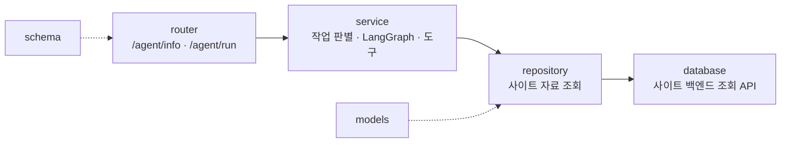

# Agent-Bot (휴버대 에이전트 봇) — 2026-11-12 구현

<!-- readme-overview -->
### 로직 구조


<!-- /readme-overview -->

가이드 챗봇([`../guidans_Chat/`](../guidans_Chat/__init__.py))이 사이트를 **설명**한다면, 에이전트 봇은 말로 시킨 **작업**을 대신 한다.
화면은 사이트 오른쪽 아래 원형 버튼 "휴버대 에이전트 봇"이고, 회원 전용이며 작업 강도만큼 포인트를 쓴다.

## 하는 일

| 작업(task) | 강도 | 내용 | 도구 |
|---|---|---|---|
| `tier_build` 티어표 초안 만들기 | 무거움 | 공식 티어표를 바탕으로 범위·이동·한 단계 올리기/내리기·제외·랜덤·제목을 말로 받아 커스텀 메이커 배치를 만든다 | `service/tools/tier_builder.py` |
| `review` 내 티어표 분석 | 보통 | 지금 커스텀 메이커에 배치한 티어표를 공식과 비교(일치율·높게/낮게 둔 캐릭터) | `service/tools/tier_review.py` |
| `digest` 게시판 · 공지 요약 | 보통 | 추천 많은 글·최근 글·최근 공지를 모아 요약 | `service/tools/digest.py` |
| `briefing` 내 활동 브리핑 | 보통 | 내 포인트·출석·뽑기·게시글 현황 + 오늘 할 만한 일 | `service/tools/briefing.py` |
| `search` 사이트 통합 검색 | 가벼움 | 캐릭터(이름 일부·티어·세부등급)·게시판·공지를 한 번에 찾아 링크로 | `service/tools/site_search.py` |

무료로 끝나는 것: 이용법 질문(→ `/ai` 안내) · 지시 무시/프롬프트 공개 요구(거절) · 못 알아들은 말 · 분석할 티어표가 없을 때.

**넣지 않은 것(평가 후 제외)**: 이용법 설명(가이드 챗봇과 중복) · 캐릭터 한 명의 티어 질문(가이드 챗봇과 중복 — 대신 조건으로 여러 명을 뽑는 검색으로 차별화) · 글·댓글·추천 대리 작성과 행운 뽑기 대리 실행(쓰기 대행은 오남용 위험이 커서 사람과 먼저 정한다).

## 흐름

```
POST /agent/run  →  plan(규칙 먼저, 애매하면 LLM JSON)  →  도구 실행(계산·조회, LLM 없음)
                 →  결과물 먼저 전송  →  해설을 LLM 이 스트리밍  →  done
```

- 응답은 줄 단위 JSON(NDJSON) 스트림이다: `plan` · `step` · `result` · `token` · `reset` · `done` · `error`(형식은 `schema/agent.py`).
- **캐릭터 이름·배치·숫자는 전부 도구가 계산한다.** LLM 은 작업 분류와 해설 글만 맡는다.
- AI 서버(Ollama)가 꺼져 있거나 LLM 이 실패하면 도구가 만든 정해진 해설로 대신한다.
- 포인트 차감·환불, 회원 확인, 요청 수 제한은 사이트 백엔드(`backend/controllers/aiAgentController.js`)가 한다. 이 서비스는 작업 강도(level)만 알린다.

## 규칙

- 폴더 이름에 하이픈(`-`)이 있어 그대로는 `import` 할 수 없다. [`../agent_loader.py`](../agent_loader.py) 가 `app.agent_bot` 패키지로 올린다 — 임포트는 `from app.agent_bot.service… import …`. 폴더 이름은 바꾸지 않는다.
- 이 폴더에는 **에이전트 봇 관련 코드만** 둔다. 가이드 챗봇의 검증된 도우미(`load_tiers`·`CharacterIndex`·`LlmStatus`)는 불러 쓰기만 한다.
- 가이드 챗봇과 **같은 6개 층**: `schema/` · `router/` · `service/` · `models/` · `repository/` · `database/`. 호출은 router → service → repository → database 한 방향.
- **MongoDB 도 Oracle 도 직접 쓰지 않는다.** 게시판·공지는 사이트 백엔드의 에이전트 봇 전용 조회 API(`/api/ai/agent/data/*`)로 읽고, 회원 정보는 백엔드가 요청과 함께 넘겨준 값만 쓴다(토큰은 오지 않는다).
- **대화 내용은 저장하지 않는다.** 저장하려면 보관 기간·탈퇴 시 삭제를 먼저 사람과 정한다.
- 모델은 따로 지정하지 않으면 가이드 챗봇과 같다(`AGENT_OLLAMA_MODEL` 비움 = `OLLAMA_MODEL`, 운영 `gemma4:e4b`). `num_ctx` 도 같은 값을 쓴다 — 다르면 Ollama 가 모델을 다시 올려 느려진다.

## 테스트

`ai-service/tests/test_agent_bot.py` — 가짜 LLM·가짜 조회 API 로 작업 판별·도구·이벤트 스트림·HTTP 를 확인한다(Ollama·백엔드 없이 돈다).
요금·한도·작업 이름이 지식 문서와 같은지는 `tests/test_knowledge_sync.py` 가 본다.

자세한 설명: [`RDMD/features/agent-bot.md`](../../../RDMD/features/agent-bot.md) · 기록: [`RDMD/ai/06-agent-bot-record.md`](../../../RDMD/ai/06-agent-bot-record.md)
