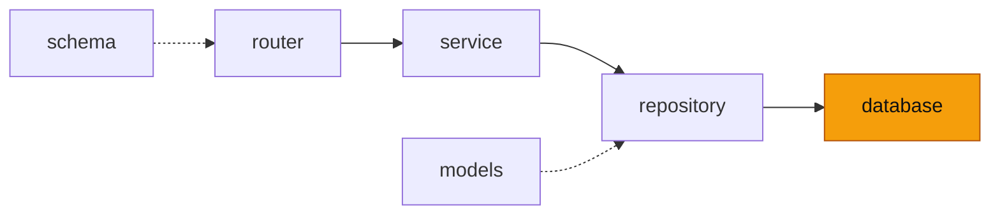

# database — 에이전트 봇 연결 층

<!-- readme-overview -->
이 폴더의 위치:

<!-- /readme-overview -->

- `site_api.py` — `SiteApi`(사이트 백엔드 조회 API 연결, 표준 라이브러리 urllib). 주소 `AGENT_SITE_API_URL`(기본 `http://127.0.0.1:5000`), `AI_SERVICE_KEY` 가 있으면 X-AI-Key 로 붙여 보낸다
- MongoDB·Oracle 연결은 없다. Oracle 이 필요해지면 가이드 챗봇의 `database/oracle.py`(python-oracledb 풀)를 참고한다
- 같은 서버 안쪽 주소만 쓴다 — 바깥 주소를 넣지 않는다.
