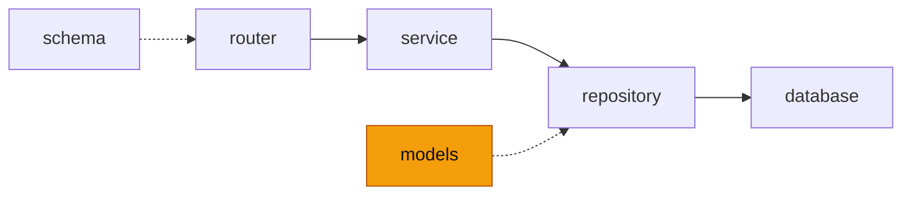

# models — 에이전트 봇이 다루는 자료의 모양

<!-- readme-overview -->
이 폴더의 위치:

<!-- /readme-overview -->

- `site.py` — `BoardPost`(게시판 글) · `SiteNotice`(공지). 사이트 백엔드가 준 JSON 에서 필요한 값만 옮겨 담는다
- Oracle 테이블 모델은 없다 — 에이전트 봇은 대화를 저장하지 않는다. 저장이 필요해지면 보관 기간·탈퇴 시 삭제를 먼저 정하고, 가이드 챗봇의 `models/`·`repository/base.py` 방식을 따른다(Oracle SQL · 바인드 변수, MongoDB 금지).
