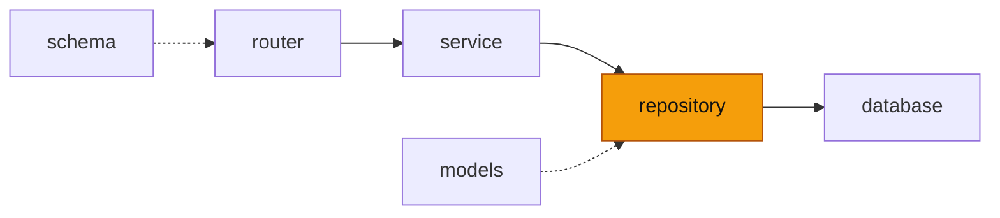

# repository — 에이전트 봇 자료 조회

<!-- readme-overview -->
이 폴더의 위치:

<!-- /readme-overview -->

- `site_repository.py` — `SiteRepository.posts()` · `post_stats()` · `notices()`. 도구는 이 클래스만 부르고 HTTP 는 모른다
- 지금은 SQL 이 없다(DB 에 직접 붙지 않음). 사이트 백엔드의 에이전트 봇 전용 조회 API(`/api/ai/agent/data/posts|notices`)를 `database/site_api.py` 로 부른다
- 가져오지 못하면 `SiteApiError` 가 올라가고, 도구가 "지금은 불러올 수 없어요"로 안내한다(서비스가 죽지 않는다).
