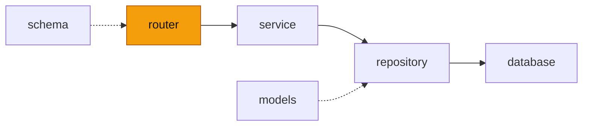

# router — 에이전트 봇 HTTP 라우터 (접두사 `/agent`)

<!-- readme-overview -->
이 폴더의 위치:

<!-- /readme-overview -->

- `agent_router.py` — `GET /agent/info`(AI 서버 ON/OFF · 모델 · 작업 목록) · `POST /agent/run`(요청 실행, NDJSON 스트림)
- 가이드 챗봇 경로(`/chat` 등)와 겹치지 않게 접두사 `/agent` 를 쓴다. 공용 키 검사(`deps.check_key`)를 그대로 쓴다.
- 브라우저가 직접 부르지 않는다. 사이트 백엔드(`/api/ai/agent/*`)가 로그인·포인트·요청 수를 확인한 뒤 부른다.
- 스트림은 동기 제너레이터라 FastAPI 가 스레드에서 돌린다. 중간에서 모아 보내지 않게 `X-Accel-Buffering: no` 를 붙인다.
