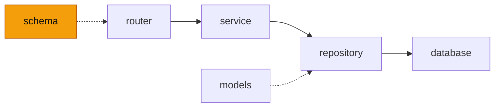

# schema — 에이전트 봇 요청·응답 스키마(pydantic)

<!-- readme-overview -->
이 폴더의 위치:

<!-- /readme-overview -->

- `agent.py` — `AgentRunRequest`(message · history · user · maker) · `UserContext`/`Attendance`(백엔드가 넘겨주는 회원 현재 상태) · `AgentInfoResponse`/`TaskInfo`
- 응답은 한 번에 오지 않고 줄 단위 JSON(NDJSON) 이벤트로 나간다: `plan` · `step` · `result` · `token` · `reset` · `done` · `error` — 형식은 `agent.py` 맨 위 설명.
- 길이 제한(`MAX_MESSAGE` 500자 등)은 사이트 백엔드 `backend/controllers/aiAgentController.js` 와 같은 값이다. 한쪽을 바꾸면 같이 바꾼다.
