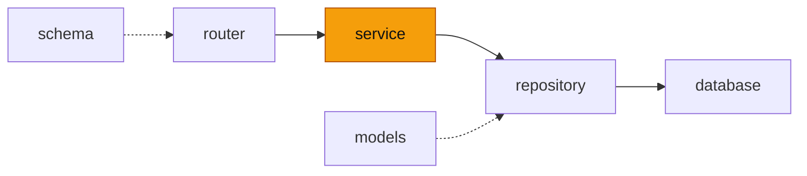

# service — 에이전트 봇 업무 로직

<!-- readme-overview -->
이 폴더의 위치:

<!-- /readme-overview -->

- `agent_service.py` — 진입(`AgentBotService`). 요청 하나를 이벤트 스트림으로 처리하고, 해설을 LLM 스트리밍으로 쓴다
- `planner.py` — 작업 판별. 규칙이 먼저(0초), 애매한 말만 LLM 에게 JSON 으로 묻는다. 작업 목록·강도(`TASKS`)도 여기 있다
- `graph.py` — LangGraph 흐름(plan → 도구 노드)
- `tools/` — 도구(작업 하나가 파일 하나): `tier_builder` · `tier_review` · `digest` · `briefing` · `site_search`. 계산·조회만 하고 LLM 을 쓰지 않는다
- `catalog.py` — 공식 티어표 카탈로그(가이드 챗봇의 `load_tiers`·`CharacterIndex` 를 불러 씀) · 커스텀 메이커 칸 이름 규칙
- `prompts.py` · `llm.py` — 해설 프롬프트 · 모델(가이드 챗봇과 같은 모델·같은 `num_ctx`, 생각 모드 끔)
