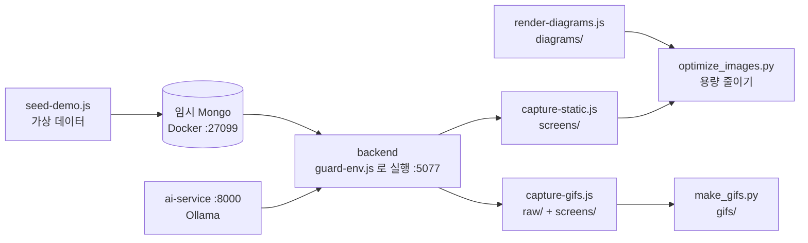

# docs/readme — README 이미지와 재생성 도구

저장소 README 들이 쓰는 이미지를 모아 둔 폴더입니다. 화면이 바뀌면 손으로 고치지 말고 여기 도구로 다시 만드세요.

```text
docs/readme/
├── diagrams/   히어로, 기술 스택, 아키텍처, AI 흐름, 기능 지도 (HTML 로 그려 PNG 로 렌더링)
├── screens/    사이트 정지 화면
├── gifs/       사이트 움직이는 장면
├── raw/        GIF 원본 프레임 (자동 생성, 커밋 안 함)
└── tools/      캡처·렌더링 스크립트
```

## 만드는 과정



## 안전 규칙

> [!CAUTION]
> `backend/server.js` 는 `backend/.env` 를 `override: true` 로 읽습니다. `MONGO_URI` 를 셸에서 넘겨도 **운영 DB 로 붙습니다.** 캡처할 때는 반드시 `guard-env.js` 로 실행하세요.

- `guard-env.js` 는 `.env` 읽기를 막고, 로컬 임시 Mongo 가 아니면 연결을 거부하며, 메일과 유튜브 동기화를 끕니다.
- 데모 계정과 글은 `seed-demo.js` 의 가상 데이터입니다. 실제 회원 정보가 찍힌 화면을 올리지 마세요.
- 캡처에 쓰는 관리자 계정과 키는 임시 DB 전용 값입니다.

## 다시 만들기

Docker, Chrome, Node.js, Python(Pillow)이 필요합니다. 레포 루트에서 실행합니다.

```bash
# 1. 도구 설치
(cd docs/readme/tools && npm install)

# 2. 임시 DB + 프론트 빌드
docker run -d --rm --name hbt-readme-mongo -p 127.0.0.1:27099:27017 mongo:7
(cd root-cloudflare && npm run build)

# 3. 서버 실행 (각각 다른 터미널)
(cd backend && node -r ../docs/readme/tools/guard-env.js server.js)
(cd ai-service && AI_SERVICE_KEY=readme-capture-only .venv/Scripts/python -m uvicorn app.main:app --host 127.0.0.1 --port 8000)

# 4. 데이터 + 캡처 (순서 유지 — capture-gifs 가 일부 화면을 더 나은 상태로 덮어쓴다)
node docs/readme/tools/seed-demo.js
node docs/readme/tools/capture-static.js
node docs/readme/tools/capture-gifs.js
python docs/readme/tools/make_gifs.py

# 5. 다이어그램 + 용량 줄이기
node docs/readme/tools/render-diagrams.js
python docs/readme/tools/optimize_images.py

# 6. 정리
docker stop hbt-readme-mongo
```

특정 장면만: `node docs/readme/tools/capture-gifs.js maker tiers` 후 `python docs/readme/tools/make_gifs.py maker tier`

> 퀴즈와 뽑기는 계정마다 하루 1회·3분 간격 제한이 있습니다. 같은 장면을 다시 찍으려면 `seed-demo.js` 를 다시 돌리거나 다른 데모 계정을 쓰세요(`LUCK_USER`, `MEMORY_USER` 환경 변수).

## 언제 고치나

| 바뀐 것 | 할 일 |
|---|---|
| 화면 디자인, 기능 | 해당 장면 다시 캡처 |
| 숫자(캐릭터 수, 페이지 수 등), 프레임워크, 서버 구조 | `tools/render-diagrams.js` 문구 수정 후 렌더링, 루트 README 숫자 표 수정 |
| AI 서비스 운영 배포 완료 | 아키텍처 그림의 "배포 준비 완료" 표시와 루트 README 안내 수정 |
