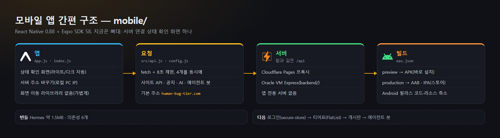
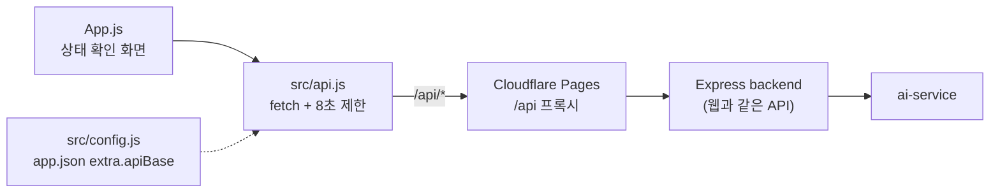

# mobile — 휴버대 티어표 모바일 앱 (React Native · Expo)

<!-- readme-overview -->


### 로직 구조


<!-- /readme-overview -->

> **뼈대 단계**(2026-11-17). 지금은 앱이 서버에 연결되는지만 확인하는 화면 하나다.
> 기능 화면(티어표·커스텀 메이커·게시판·에이전트 봇)은 다음 단계에서 웹과 같은 `/api` 에 붙인다 — 앱 전용 서버는 없다.

## 한눈에

| 항목 | 값 |
|---|---|
| 프레임워크 | React Native 0.88 + **Expo SDK 58**(JavaScript — 웹 프론트 `root-cloudflare/` 와 같은 언어·React 방식) |
| 대상 | Android · iOS 한 코드로 둘 다(EAS Build 로 APK·AAB·IPA) |
| 앱 ID | `com.humanbugtier.app` (Android package · iOS bundleIdentifier) |
| 서버 | 기본 `https://human-bug-tier.com` (`app.json` → `expo.extra.apiBase`), 화면에서 바꿀 수 있음 |
| 화면 | 상태 확인 — 사이트 API(`/api/site/status`) · 공지(`/api/notices?limit=1`) · AI 도우미(`/api/ai/status`) · 에이전트 봇(`/api/ai/agent/info`) |

## 파일

```
mobile/
├── App.js            상태 확인 화면(한 화면, 라이트/다크 자동)
├── index.js          진입점(registerRootComponent)
├── src/config.js     서버 주소·요청 시간 제한
├── src/api.js        fetch 래퍼 + 확인 항목(CHECKS) — 동시에 보내고 한 번에 그린다
├── app.json          앱 이름·아이콘·앱 ID·축소 빌드 설정(expo-build-properties)
├── eas.json          빌드 프로필(preview = 바로 설치하는 APK, production = 스토어용 AAB/IPA)
└── assets/icon.png   앱 아이콘(웹 PWA 아이콘과 같은 그림)
```

## 가볍게 만든 방법

웹보다 기기 사양·회선이 약하므로 처음부터 무게를 늘리지 않는다.

- 의존성은 `expo` · `expo-constants` · `expo-status-bar` · `expo-build-properties` · `react` · `react-native` 뿐 — 화면 이동·상태 관리 라이브러리를 넣지 않았다(필요해지면 그때 추가).
- JS 는 Hermes 바이트코드로 묶인다(실측 번들 약 1.5MB, 596개 모듈).
- Android 릴리스 빌드에 코드 축소(ProGuard)와 리소스 축소(shrinkResources)를 켰다.
- 앱에 묶는 그림은 아이콘 하나(`assetBundlePatterns: ["assets/*"]`). 캐릭터 이미지 같은 큰 그림은 앱에 넣지 않고 서버에서 필요할 때 받는다.
- 요청은 동시에 보내고 8초에 끊는다. 화면은 결과를 모아 한 번에 그린다.
- 응답이 작은 API 를 쓴다 — 상태 확인용 `GET /api/site/status`(백엔드 `routes/siteRoutes.js`)를 따로 만들었다.
- 앞으로 목록 화면은 `FlatList`(보이는 것만 그림), 이미지는 작은 썸네일로 받는다.

## 실행

```bash
cd mobile
npm install
npx expo start           # QR 코드 → 휴대폰의 Expo Go 앱으로 열기
```

- 로컬 백엔드에 붙이려면 같은 Wi-Fi 에서 `cd backend && npm start` 후, 앱 화면의 "서버 주소"에 `http://<PC IP>:5000` 을 넣는다(휴대폰의 `localhost` 는 PC 가 아니다).
- 코드가 묶이는지만 볼 때: `npm run check`(Android 번들을 `.expo-check/` 에 만든다, gitignore).

## 설치 파일 만들기 (Android · iOS)

[EAS Build](https://docs.expo.dev/build/introduction/)(Expo 클라우드 빌드)로 만든다. Expo 계정이 필요하다(`npx eas-cli login`).

| 명령 | 결과 | 용도 |
|---|---|---|
| `npm run build:apk` | Android **APK** | 링크로 바로 내려받아 설치(테스트·지인 배포) |
| `npm run build:android` | Android **AAB** | Google Play 등록 |
| `npm run build:ios` | iOS **IPA** | App Store / TestFlight (Apple 개발자 계정 필요) |

처음 빌드할 때 `eas build:configure` 가 프로젝트 ID 를 `app.json` 에 넣는다. 서명 키는 EAS 가 만들어 보관한다 — 키 파일(`*.jks`, `*.p8`, `credentials.json`)은 커밋하지 않는다(`.gitignore`).

## 지금 상태와 다음 단계

- 확인함: `npx expo install --check` 통과, Android·iOS JS 번들 생성(`expo export`), 확인 항목 로직을 Node 에서 운영 주소로 실행(공지·AI·에이전트 봇 OK).
- `GET /api/site/status` 는 새로 만든 API 라 백엔드를 배포하기 전에는 운영에서 404 로 나온다(사이트 API 줄만 빨간색).
- 실제 기기·에뮬레이터 실행과 EAS 빌드는 아직 하지 않았다(Expo 계정 필요).
- 다음: 로그인(웹과 같은 JWT, `expo-secure-store` 에 보관) → 공식 티어표 → 게시판 보기 → 에이전트 봇.
